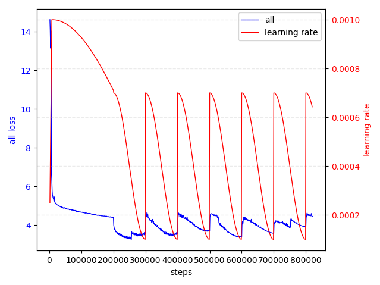
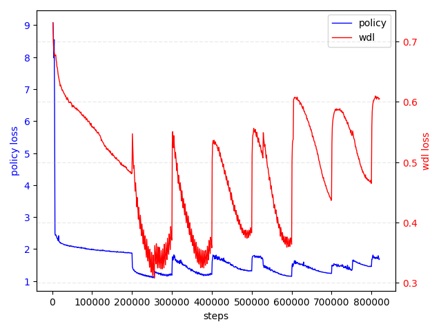
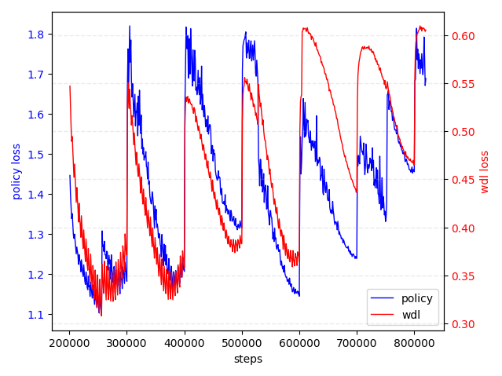
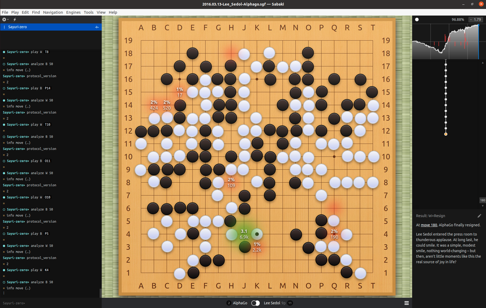
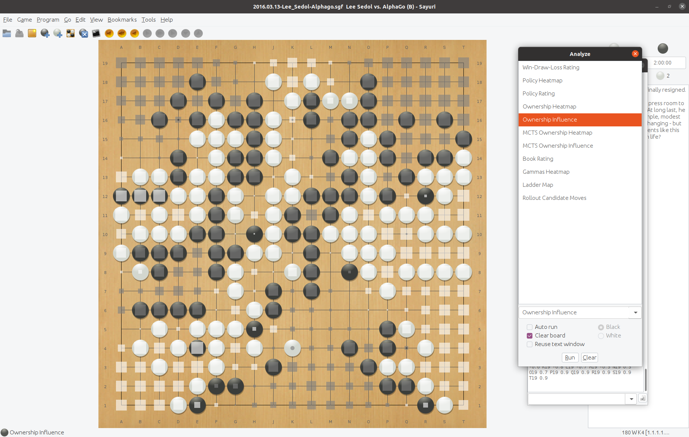
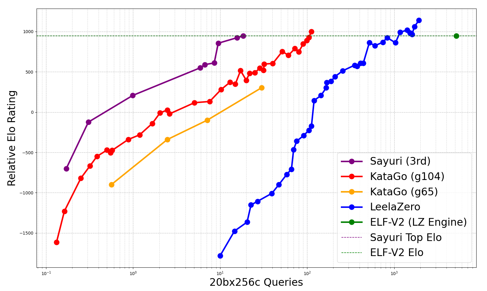

<div id="sayuri-art" align="center">
    </br>
    
    <h3>Sayuri</h3>
</div>

# TensorRT backend for ONNX

This is a prototype of the TensorRT backend for ONNX (onnx-tensorrt) designed for Sayuri.
AQ already adopted this method (using UFF instead of ONNX) in 2018, but there were still many restrictions at that time, so it was not adopted in the Go engine for a while.
Also added the following features:
* Muon+AdamW optimizer (Ported KataGo v1.18)
* Aurora+AdamW optimizer (Ported KataGo v1.18)
* FlexAttention (Ported KataGo v1.18)
* torch.compile (Ported KataGo v1.18)
* TransformerAttention model for experimental purposes (Ported KataGo v1.18)
* Automatic learning rate scheduling (cosine annealing)
* Support for bfloat16 in AMP (PyTorch Automatic Mixed Precision)

## Requirements

Additional features require the following installation:

* c++ engine: onnx runtime (Used onnxruntime-linux-x64-1.25.1 to check the operation)
* python: pip install onnxruntime-gpu onnx onnxscript

## Modification of configuration definitions (selfplay-setting.json)

Additional configuration definitions (selfplay-setting.json):
```
  "NeuralNetwork" : {
    "ReductionInput": false(default)  # Should it be trained using minimal local input features? (true|false)
    "FFNExpansionRatio": 1.5(default) # What should be the multiplier for the number of output channels of the convolution
                                      # immediately following the DepthwiseConv in MixerBlock,
                                      # relative to the number of channels in the intermediate layer?
    "TransformerDropRate": 0.0(default) # Dropout rate used in the TransformerAttentionBlock.
    "BatchNormMode": "renorm"(default)  # Type of batch normalization to use. ("renorm"|"norm"|"fixup")
                                        # In the TransformerAttentionBlock, RMSNorm is fixed.
    "PreActivation": false(default) # Should batch normalization and activation be performed before the convolution? (true|false)
                                    # In the TransformerAttentionBlock, PreNorm is fixed.
    "FinalBlockCgroupSize": None(default) # If specified, RMSNorm is performed using this group size at the end of the intermediate layer's iterative processing.
    "AttentionQKNorm": true(default)  # RMSNorm on Q and K per-head before the attention dot product. (true|false)
    "TransformerHeads": 3(default)    # The number of parallel heads processed in Multi-Head Attention.
    "TransformerKVHheads": 3(default) # The number of parallel heads processed in Multi-Head Attention.
    "AttentionQueryHeadDim": "ResidualChannels" / "TransformerHeads"(default) # Query size (number of dimensions) per head.
                                         #  = Hidden layer dimension / Number of attention heads.
                                         # The recommended value is 64.
    "AttentionValueHeadDim": "ResidualChannels" / "TransformerHeads"(default) # Value size (number of dimensions) per head.
                                         #  = Hidden layer dimension / Number of attention heads
                                         # The recommended value is 64.
    "LearnedRoPECastToInputDtype": true(default) # Under AMP, cast the small cos/sin rotation tables to the input dtype
                                                 # before the batch-sized Q/K rotation,
                                                 # instead of promoting the batch-sized rotation intermediates to FP32.
                                                 # The trigonometric functions themselves remain FP32.
    "TransformerFFNRatio": 4(default) # By what factor should the expanded channel count in the feed-forward network within the TransformerAttentionBlock
                                      # be set relative to the number of channels in the intermediate layer?
    "UseSwiGLU": true(default) # Should SiLU be used for the activation within the Feed-Forward Network of the TransformerAttentionBlock? (true|false)
                               # If set to false, the activation function specified in "Activation" is used.
    "TransformerFFNDepthwiseConv": true(default) # Should DepthwiseConv be used within the feed-forward network of a TransformerAttentionBlock? (true|false)
    "FusedQKVProj": false(default) # Compute the transformer Q/K/V projections (and the SwiGLU input/gate projections)
                                   # as one GEMM each over on-the-fly concatenated weights.
                                   # Set to 0 to run them as separate matmuls.
    "FusedSwigluKernel": false(default) # Under fp16/bf16 autocast on CUDA, compute the SwiGLU FFN input projection with the fused
                                        # Triton dual-GEMM kernel in katago.train.fused_swiglu, which never materializes the two
                                        # pre-gating intermediates. fp32 (non-autocast) paths, CPU, and export are unaffected. (true|false)
    "FusedRoPEBackward": false(default) # On CUDA with learnable RoPE and the fused Q/K/V projection,
                                        # apply RoPE with the Triton custom ops in katago.train.fused_rope:
                                        # one forward kernel that rotates and writes Q, K, V in attention layout,
                                        # and one backward kernel that writes the packed Q/K/V gradient directly.
                                        # The backward kernel is the main saving. Grouped-query attention and
                                        # register tokens are not supported and fall back to the plain path.
                                        # Under torch.compile this is only safe with the per-block compiled trunk,
                                        # so trainloop_helpers.configure_model_for_compile turns it (and the fused Q/K/V projection) off
                                        # when the model is compiled as a single graph. (true|false)
    "UseTAB": false(default) # Should we use Topological Attention Bias? (true|false)
    "TABD1": 16(default) # Number of output channels for TAB first Layer.
    "TABD2": 16(default) # Number of output channels for TAB second Layer.
    "TABCZ": 32(default) # Number of TAB frequencies.
    "TABNumTemplates": 32(default) # Number of TAB templates.
    "TABNumFreqs": 8(default)  # Number of TAB frequencies.
    "TABNumBlocks": 3(default) # Number of TAB blocks.
    "TABDilation": 3(default)  # Dilation for conv2d in TAB.
    "UseFlexAttention": false(default)  # Should we use PyTorch's FlexAttention? (true|false)
    "AttnLogitPenaltyCap": None(default)      # Penalize attention layers whose per-head logit upper bound (scale * max||q|| * max||k||, incl off-board positions) exceeds this. None = disabled.
    "AttnLogitPenaltyCoeff": 1e-3(default)    # Loss coeff for the attention logit bound penalty (linear hinge, mean over heads, sum over layers, per sample)
    "AttnLogitPenaltyBatchFrac": 1.0(default) # Compute the attention logit penalty on only this fraction of each batch (cuts its cost proportionally, adds gradient variance)
  "Train" : {
    "Optimizer": "SGD"(default)                    # ("SGD"|"Adam"|"Muon"|"Aurora")
    "LearningRateSchedule": [[0, 0.2]](default)    # first:  Number of steps at schedule start.
                                                   # second: Initial value of the learning rate.
                                                   # third:  Final value of the learning rate. (optional)
    "LearningRateAnnealingCycle": 500000(default)  # Learning rate annealing cycle. (number of steps)
    "HeadLrFactor": 0.5(default)        # LR factor for output policy head weights.
    "ValueLrFactor": 0.5(default)       # LR factor for output value head weights.
    "NoregLrFactor": 1.0(default)       # LR factor for noreg params. (biases, norms)
    "ValueNoregLrFactor": 1.0(default)  # LR factor for value head noreg params. (biases, norms)
    "MuonAdamLrFactor": 2.5(default)    # LR factor for muon-ineligible (adam) params when using muon.
    "InputWdFactor": 1.0(default)       # Extra scaling factor for input weight decay.
    "NormalWdFactor": 1.0(default)      # Extra scaling factor for normal weight decay.
    "NormalAttnWdFactor": 1.0(default)  # Extra scaling factor for normal_attn weight decay.
    "ExportONNX": false(default)        # Should we export the trained model using torch.onnx.export? (true|false)
    "UseDynamo": true(default)          # Should we use TorchDynamo when exporting with torch.onnx.export? (true|false)
    "UseCompile": false(default)        # Should we use torch.compile? (true|false)
    "UseBatchedMuonNs": true(default)   # Stack Muon updates with the same
                                        # matrix shape (up to KATAGO_MUON_NS_BATCH_SIZE, default 32) into a single
                                        # compiled Newton-Schulz iteration rather than one launch sequence per
                                        # parameter. Same update equations, but not bitwise identical to the scalar launches.
    "UseForeachAuxAdam": true(default)  # Use torch._foreach multi-tensor kernels for the auxiliary Adam parameter groups.
    "MuonNsBatchSize": 32(default)      # Newton-Schulz batch size.
    "WdFloorFraction": 0.5(default)     # Exempt from weight decay the part of each output channel of each weight matrix
                                        # whose RMS is below this fraction of the tensor's RMS at initialization,
                                        # so that unused channels never decay to exactly zero,
                                        # a state Muon cannot recover from.
                                        # Can be changed between runs.
                                        # Requires muon.
                                        # Minimum floor fraction for the weight decay schedule. (0.2 - 0.5)
    "WdlLossScale": 1.0(default)        # Scaling factor for WDL loss during loss calculation.
    "ScoresLossScale": 150(default)     # Scaling factor for errors loss calculation.
    "GnormClipScale": 1.0(default)      # Scale relative to the default gradient clipping value.
```
Deletion configuration definition (selfplay-setting.json):
```
  "Train" : {
    "RenormMaxR": 1(default)
    "RenormMaxD": 0(default)
```
## Build
```
 $ cmake .. -DBLAS_BACKEND=TENSORRT -DUSE_ZLIB=1 -DSPECIFIC_BOARD_SIZE=9 -DBOARD_SIZE=9 -DONNX_ROOT_DIR=~/Downloads/onnxruntime-linux-x64-1.25.1
 $ cmake --build .
 $ ./sayuri -t 10 -b 5 -w ~/Sayuri-test-b9xc192/weights/sayuri-b9xc192-s300000-c315000-w61965-swa.onnx --use-optimistic-policy --scoring-rule area -p 1200 --reuse-tree
```
## Technical Report: "Chasing Sai"

— Breaking Overfitting and Achieving Full Generalization in 9x9 AlphaZero Reinforcement Learning —

This project documents the journey of "Project Sayuri," where a lightweight architecture (b9xc192h64 RRT3) trained from a completely random scratch initialization (zero state). Utilizing Gumbel MCTS (250 playouts during self-play) alongside cutting-edge mathematical optimizations and decisive hyperparameter interventions, Sayuri successfully reached a level of play that completely overwhelms and outgrows the deeply searching, powerful benchmark bot "sai" (1200 playouts).

## 5 Core Technical Insights

1. Fast Overfitting to "In-Group Meta" and Deceptive Convergence

In the mid-phase of reinforcement learning (200K+ steps), a narrow Replay Buffer window forces the core convolutional layers (governed by Muon) to specialize entirely in memorizing the repetitive, comfortable endgame patterns of self-play. During this phase, internal training losses plummet to a "god-like" convergence. However, the network suffers from catastrophic forgetting, losing its robust immunity against the non-standard, aggressive overplays thrown by an external opponent like sai. True strength requires the continuous maintenance of exploratory noise and diversity.

2. Asymmetric Optimization via High-LR AdamW

The ratio between the learning rates of Muon (governing the core backbone) and AdamW (governing the policy/value headers and leRoPE position embeddings) is the definitive factor for policy entropy (breadth of vision). Setting the AdamW learning rate to a highly responsive 2.5x relative to Muon acts as a catalyst; it unlocks frozen policy headers and drives lightning-fast recalibration to external meta-strategies.

3. Boosting Parameter Efficiency with flex-attention

The integration of flex-attention (dynamic attention masking) at 380K steps fundamentally bypassed the physical size limitations of a lightweight 9-block, 192-channel network. By dynamically dropping computations related to illegal moves and fully settled territories, 100% of the model's capacity was directed toward critical local fights and exact endgame counting, effectively scaling the network's cognitive ceiling.

4. The Golden Buffer Scale: Guarding Against Memory Decay

Smaller models are inherently vulnerable to catastrophic forgetting when bombarded with fresh data. By fine-tuning the parameters of the growth curve formula, the retention window size was dynamically expanded to over 200,000 chunks (~44% of the total dataset). This anchor allowed a high density of Sayuri's older, scrappy fighting data to coexist with the newer refined strategies, fully restoring her robust defense against sai's deep tactical traps.

5. Active Data Selection via policy_surprise_factor

The ultimate unlock for Sayuri's field of vision was the activation of the Kullback-Leibler Divergence (KLD) data auditing filter. Elevating the policy_surprise_factor to 0.5 eliminated the bottom 80% of mundane, predictable self-play endgames. Instead, the replay buffer was forcefully packed with high-surprise, high-KLD edge cases—scenarios where the raw policy was completely blindsided by deep MCTS readouts. This triggered a powerful "re-exploration" surge, pushing the policy loss back up to a healthy 1.6+ range and infusing the model with a fierce finishing power.

## Key Achievements & Milestones

- Autonomous Awakening from True Zero:
Without a single human game or a single line of pre-trained legacy weights, Sayuri independently cultivated professional-grade life-and-death reading and global positional judgment entirely through a lightweight Gumbel 250 self-play loop. 

- Crushing the 1200-Playout Benchmark:
At 820K steps, Sayuri established absolute dominance over sai's deep 1200-playout tree search, recording 20 Wins / 18 Draws as Black (先番) and 12 Wins / 10 Draws as White (後番), while limiting her losses to an all-time low. This represents a complete dethroning of the benchmark environment. 

- The Paradox of High Loss and Elite Strength:
This run mathematically demonstrated that a plateaued or slightly elevated wdl loss (Value Loss) at the tail end of training is not a sign of stagnation or failure; rather, it proves that the buffer is highly enriched with high-signal, ultra-difficult problems (Gumbel 250 meta), indicating that the network is successfully wrestling with true generalization. 

## Technical Highlights
- **Active Data Selection:** Leveraged `policy_surprise_factor=0.5` via KLD sampling to filter out mundane positions and focus entirely on high-surprise, critical life-and-death situations. 
- **Asymmetric Optimizer Scaling:** Deployed high-LR AdamW (2.5x Muon LR) to unfreeze policy headers and drive lightning-fast adaptations to external meta-strategies. 
- **Architectural Boost:** Integrated PyTorch's `flex-attention` to maximize parameter efficiency, enabling a lightweight 9-block, 192-channel model to possess professional-grade finishing ability. 

## Loss graph







## Record vs. against Sai
```
steps lr     elo     b(w/d/l)   w(w/d/l)
----- ----   ----    ---------- --------- 
 220K 6e-4 : 1634 -> (7/7/92)   (7/12/75) 
 240K 5e-4 : 1588 -> (2/7/81)   (3/8/99)  
 260K 3e-4 : 1581 -> (2/10/93)  (0/7/88)  
 280K 2e-4 : 1567 -> (1/4/91)   (1/6/97)  
 300K 7e-4 : 1585 -> (1/4/79)   (3/10/103)
 320K 6e-4 : 1585 -> (3/3/88)   (3/8/95)  
 340K 5e-4 : 1579 -> (5/3/81)   (2/3/106) 
 360K 3e-4 : 1577 -> (2/1/95)   (3/8/91)  
 380K 2e-4 : 1582 -> (0/4/94)   (4/9/89)  
 400K 7e-4 : 1551 -> (0/2/92)   (0/6/100) 
 420K 6e-4 : 1641 -> (8/12/87)  (6/11/76) 
 440K 5e-4 : 1620 -> (5/12/90)  (3/12/78) 
 460K 3e-4 : 1596 -> (9/4/85)   (2/3/97)  
 480K 2e-4 : 1576 -> (2/1/103)  (4/7/83)  
 532K 6e-4 : 1616 -> (4/13/92)  (6/5/80)  
 540K 5e-4 : 1639 -> (11/13/78) (5/6/87)  
 600K 7e-4 : 1564 -> (2/4/103)  (1/3/87)   "ChunksIncreasingScale" : 2.5 (1.0 -> 2.5)
 620K 6e-4 : 1666 -> (12/6/82)  (10/14/76) "PolicySurpriseFactor" : 0.5 (0.0 -> 0.5)
 640K 5e-4 : 1687 -> (13/15/75) (20/12/65)
 660K 3e-4 : 1649 -> (13/10/81) (7/10/79)  --playouts 250 (150 -> 250)
 700K 7e-4 : 1622 -> (8/10/86)  (4/8/84)  
 720K 6e-4 : 1675 -> (11/23/65) (9/12/80) 
 740K 5e-4 : 1687 -> (19/15/57) (7/13/89) 
 760K 3e-4 : 1665 -> (16/12/86) (10/9/67)  "UseFlexAttention" : true (false -> true)
 780K 2e-4 : 1649 -> (10/15/78) (5/13/79) 
 800K 7e-4 : 1625 -> (6/9/88)   (9/5/83)  
 820K 6e-4 : 1698 -> (20/18/70) (12/10/70)
```


The following is the original README for Sayuri.

## Let's ROCK!

**Sayuri** is a GTP-compliant Go engine built on Deep Convolutional Neural Networks and Monte Carlo Tree Search. It learns to play Go from scratch using an AlphaZero-style algorithm, without any handcrafted human strategies. Inspired heavily by **Leela Zero** and **KataGo**, Sayuri initially borrowed its board data structures, search algorithms, and network format from Leela Zero. In later versions, the engine follows KataGo's research and now supports variable rulesets, komi settings, and board sizes.

For development insights and reports, see:
* [Development Log (in Chinese)](https://hackmd.io/@yrHb-fKBRoyrKDEKdPSDWg/BJgfay0Yc)
* [Performance Report before UEC15 (v0.6)](https://drive.google.com/file/d/1ATd_u-E-OnviczsDH8wVL0c3Q1NzUCKW/view?usp=share_link)


## Quick Start via Terminal

To run the engine, you need a executable weights first. The released weights can be got from this [page](./docs/MODEL.md). Then launching the engine with GTP mode via the terminal/PowerShell, using 1 thread and 400 visits per move with optimistic policy. Please type

    $ ./sayuri -w <weights file> -t 1 -p 400 --use-optimistic-policy


After executing the command, you'll see diagnostic output. If this output includes ```Network Version```, it indicates that the engine is successfully running in GPT mode. However, since GPT mode isn't designed for human interaction, you should use the graphical interface (GUI) instead. Please refer to the **Graphical Interface** section for more details.

For a list of additional command-line arguments, use the --help option. Please type:

    $ ./sayuri --help

The default engine uses a Chinese-like rule, which has a tendency to keep playing to remove some dead stones, even when their ownership of an area is clear. This can lead to unwanted capturing moves. To prevent these unnecessary moves, you have two options. First, while using the Chinese-like rule, add the ```--friendly-pass``` option. Second, switch to a Japanese-like rule by using the ```--scoring-rule territory``` option.

You can utilize the pure Python engine with a checkpoint model. The released checkpoint models could be found from this [page](./docs/MODEL.md). Although the Python engine is significantly weaker than the C++ engine, it makes running the raw model much easier. More detail you may see [here](./train/README.md).

    $ python3 train/torch/pysayuri.py -c model.pt --use-swa

## Execute Engine via Graphical Interface

Sayuri is not complete engine. You need a graphical interface for playing with her. She supports any GTP (version 2) interface application. [Sabaki](https://sabaki.yichuanshen.de/) and [GoGui](https://github.com/Remi-Coulom/gogui) are recommended because Sayuri supports some specific analysis commands.

* Sabaki analysis mode



* GoGui analysis commands



## Build From Source

For instructions on building from source, please refer to this [section](./docs/COMPILE.md). If you are using Windows, you can download a precompiled executable directly from the release page.

## Reinforcement Learning

Sayuri is a highly efficient self-play learning system for the game of Go that focuses on computational efficiency. In her v0.7 release, Sayuri’s training cost (represented by the purple line) is notably lower than that of both KataGo and Leela Zero. Compared to ELF OpenGo, Sayuri requires approximately 250× less computation. The complete training run was conducted in three months using a single RTX 4080 GPU. By comparison, KataGo’s g104 version reports a reduction of around 50×, making Sayuri’s efficiency improvement considerably larger.

For details on how to run the self-play loop, please refer to this [guide](./bash/README.md).



## Acknowledge

TensorRT Backend: The TensorRT backend has now been implemented in this project. Special thanks to [MAOmao000](https://github.com/MAOmao000) for providing a fully functional [TensorRT version](https://github.com/MAOmao000/Sayuri-TensorRT) and verifying that it delivers approximately 1.5x the performance of the original CUDA backend. Much of the TensorRT backend implementation in this project was adapted from that version and integrated to match the coding style of Sayuri.

## Other Resources

* Go Text Protocol, [https://www.gnu.org/software/gnugo/gnugo_19.html](https://www.gnu.org/software/gnugo/gnugo_19.html)
* Leela Zero, [https://github.com/leela-zero/leela-zero](https://github.com/leela-zero/leela-zero)
* KataGo methods, [https://github.com/lightvector/KataGo/blob/master/docs/KataGoMethods.md](https://github.com/lightvector/KataGo/blob/master/docs/KataGoMethods.md)
* [YouTube](https://www.youtube.com/watch?v=82UclNrXGxg), playing with Pachi.
* Supported analysis commands, [analyze](./docs/ANALYZE.md).
* [AlphaZero 之加速演算法實作 (v0.4~v0.5)](https://hackmd.io/@yrHb-fKBRoyrKDEKdPSDWg/HJI9_p70i), describe some methods for old version.

## License

The code is released under the GPLv3, except for threadpool.h, cppattributes.h, Eigen and Fast Float, which have specific licenses mentioned in those files.

## Contact

cglemon000@gmail.com (Hung-Tse Lin)
