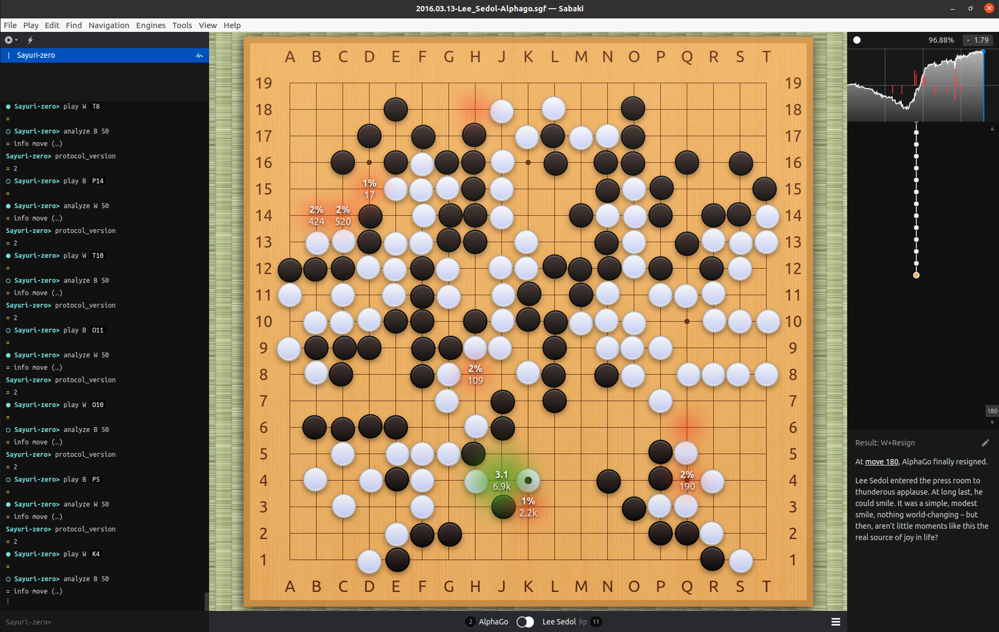
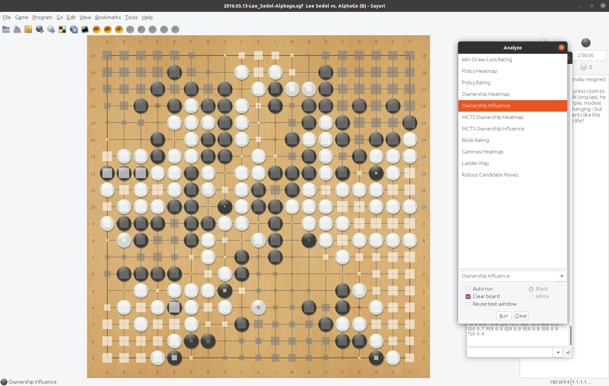
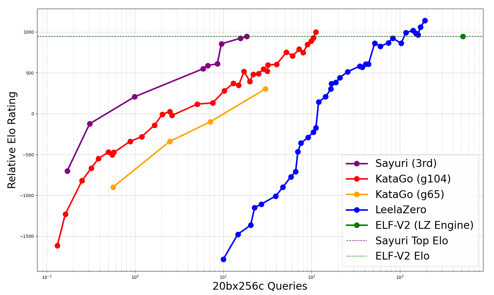

<div id="sayuri-art" align="center">
    <br/>
    
    <h3>Sayuri — Muon × AlphaZero Experimental Fork</h3>
</div>

# Chasing the Shadow of SAI: The Marriage of AlphaZero and the Muon Optimizer

This repository contains experimental results, training configurations, and logs aimed at reaching the playing strength of **SAI** (*Sensible Artificial Intelligence*) using a compact **Hybrid ResNet-Transformer** trained with **Head-Split Muon** and **Gumbel AlphaZero** on top of the open-source Sayuri engine.

> **⚠ Note on Releases & Precompiled Binaries:**  
> This is an active research fork of [Sayuri](https://github.com/CGLemon/Sayuri). **No precompiled binaries or GitHub Releases are published here**—please build from source using the [Build instructions](#requirements--build) below or explore the training logs and benchmark results directly.

---

## 🧭 Quick Navigation

* 📊 **[Benchmark Summary](#2-cross-experiment-benchmark-summary-vs-sai-b8c160)** — 200-game match results vs. `SAI b8c160` (`Exp 1` – `Exp 7`) & `Sayuri b12xc384nbt`
* 📝 **[Experiment-by-Experiment Technical Breakdown](./docs/exp_report.md)** — Detailed analysis, loss curves, and failure modes
* 📁 **[Experimental Results & Logs](./experimental_results)** — Raw evaluation outputs and training records
* ⚙ **[Sample Training Configs](./bash/configs/sample)** — Ready-to-use `selfplay-setting.json` presets
* 🛠 **[Build & Inference Guide](#requirements--build)** — C++ ONNX Runtime / TensorRT compilation steps
* 🌐 **[Broader Implications for Big Data](#6-broader-implications-lessons-from-rl-for-big-data--diversity-preservation)** — Lessons on diversity preservation and echo chambers from RL

---

## About SAI (Sensible Artificial Intelligence)

**SAI (Sensible Artificial Intelligence)** is an open-source Go engine based on the Leela Zero framework, designed to handle variable komi and handicap games.

### History & Developers
* **Developers**: Developed by an Italian research team led by Francesco Morandin (along with Gianluca Amato, Rosa Gini, Carlo Metta, Maurizio Parton, Gian-Carlo Pascutto, and Marco Fantozzi).
* **Release Period**: 2018 – 2019

### Key Features
* **Variable Komi & Handicap Support**: Evaluates win rates across different komi values by modeling them with a sigmoid function.
* **Self-Play Reinforcement Learning**: Trained purely through self-play without relying on human game records.
* **Score Margin Estimation**: Capable of estimating score differences and targeting higher margins rather than just maximizing win probability.

### References
* [SAI, a Sensible Artificial Intelligence that plays Go (arXiv:1809.03928, 2018)](https://arxiv.org/abs/1809.03928)
* [SAI: a Sensible Artificial Intelligence that plays with handicap and targets high scores in 9x9 Go (arXiv:1905.10863, 2019)](https://arxiv.org/abs/1905.10863)

---

## Key Highlights
- **The Marriage of AlphaZero & Muon:** Demonstrating how the **Muon optimizer** significantly accelerates and improves the training of AlphaZero-style reinforcement learning algorithms.
- **Target Benchmark:** Evaluating playing strength and Elo progression against **SAI** (*Sensible Artificial Intelligence*).
- **Contents:** Training configurations, loss curves, and cross-engine evaluation logs.

## 1. Overview & Motivation (TL;DR)
In AlphaZero-style board game AI, conventional scaling laws typically assume that stronger play requires massive neural networks trained over millions of steps. However, for single-GPU developers, researchers, and edge/browser deployments, the critical question is: **How small can a model be—and how few training steps does it need—to match established larger engines?**

Additionally, applying fast learning optimizers with large update steps such as Muon to AlphaZero-style reinforcement learning runs a high risk of imbalance between data generation (MCTS) and network updates, leading to severe overfitting and training instability in non-stationary environments.
The main issues can be summarized into four points:
* Overfitting to non-stationary targets: In AlphaZero, the “ground truth” (MCTS policy targets and game outcomes) constantly changes as self-play progresses. If the updates are too fast, the network will rapidly overfit to inaccurate value estimates and biased trajectories from early immature stages, destroying the diversity of the search and trapping the agent in a local optimum.
* Noise amplification due to lack of variance adaptation: As noted in Hugging Face's RL field notes, Muon lacks a second-moment mechanism (like Adam) that automatically attenuates the step size when the gradient variance is large. As a result, noisy RL gradients and infrequent reward spikes are orthogonalized and applied at full scale, easily causing policy and value collapse at later stages of training.
* Runaway feedback loop with MCTS: The output of the network (prior probabilities and state values) is immediately fed back to the next MCTS search tree. When the rate of optimization exceeds the generation of self-play data, the network repeatedly performs large-scale updates to old replay buffer data, creating a vicious cycle in which suboptimal moves and overestimated values are reinforced through MCTS.
* Over-orthogonalization prevents late-stage convergence: Muon's Newton-Schulz orthogonalization prevents representation collapse and speeds up early exploration (“exploration”), but tends to keep the entropy of the policy too high in the final convergence phase (“parking”), making it difficult to harden the policy for accurate endgame computation.

This is an experiment in the dark to find out how to avoid overfitting while balancing the diversity of data provided.

For this experiment, we used "Sayuri" (https://github.com/CGLemon/Sayuri.git)—a compact Go bot that already provides a solid foundation—after extending it with the features required for our experiments. The primary additions are listed below; most of these were ported from features introduced in KataGo v1.18.

* Muon+AdamW optimizer (Ported KataGo v1.18)
* Aurora+AdamW optimizer (Ported KataGo v1.18)
* FlexAttention (Ported KataGo v1.18)
* torch.onnx.export (Ported KataGo_Transformer (https://github.com/hzyhhzy/KataGo_Transformer.git))
* torch.compile (Ported KataGo v1.18)
* TransformerAttention encoder (Ported KataGo v1.18)
* Automatic learning rate scheduling (cosine annealing)
* Support for bfloat16 in AMP (PyTorch Automatic Mixed Precision)
* Support for Muon Split (Referred to lc0)

Using **9x9 Go (Chinese rules, Komi 7.0)** as a testbed, we combined a **Hybrid ResNet-Transformer architecture** with modern optimization techniques (**Head-Split Muon**, **$\mu$P width scaling**, and **Gumbel AlphaZero**). Our experiments demonstrate that a compact **`b6xc128h32` (`RRTRRT`, 6-block, 128-channel)** network trained in a **single 310K-step cycle (~400K self-play games) without warm restarts** **outperforms the larger `SAI b8c160` (8-block, 160-channel ResNet) baseline (`52.25%` Point Win Rate / `+16 Elo`)**—winning across both Black and White colors.

## 2. Cross-Experiment Benchmark Summary (vs. `SAI b8c160` & Upstream `Sayuri`)

All evaluation matches consist of **200 games** (~100 as Black, ~100 as White) on 9x9 Chinese rules (`Komi 7.0`, `1,200 playouts/move`) using SWA (Stochastic Weight Averaging) weights.

> **Evaluation Metrics Note (Point Win Rate vs. Non-Loss Rate):**
> Because 9x9 Go with Komi 7.0 frequently ends in a theoretical draw (*Jigo*) under optimal play, evaluating solely by Non-Loss Rate (`W + D`) can be misleading. We therefore use **Point Win Rate (`(W + 0.5 * D) / 200`)** and **Estimated Elo Difference** as our primary strength metrics alongside Non-Loss Rate.

| Experiment | Model Topology | Training & Key Innovations | Black (`W/D/L`) | White (`W/D/L`) | Total (`W/D/L`) | **Point Win Rate** | **Est. Elo Diff** | Non-Loss (`W+D`) |
| :--- | :---: | :--- | :---: | :---: | :---: | :---: | :---: | :---: |
| **Exp 1 (Baseline)** | `b6xc96h32` (`96ch`) | Initial Muon + Gumbel AZ (`512K`) | 17 / 20 / 63 | 14 / 17 / 69 | 31 / 37 / 132 | `24.75%` | `-193 Elo` | `34.0%` |
| **Exp 2 (Naive Scale)** | `b6xc192h64` (`192ch`) | Un-split Muon + Restart (`392K`) | 23 / 22 / 58 | 25 / 18 / 54 | 48 / 40 / 112 | `34.00%` | `-115 Elo` | `44.0%` |
| **Exp 3 (Giant Killing)** | `b6xc96h32` (`96ch`) | **Head-Split Muon** + RMSNormMask (`312K`) | 31 / 26 / 39 | 21 / 13 / 70 | 52 / 39 / 109 | `35.75%` | `-102 Elo` | `45.5%` |
| **Exp 3.5 (Restart)** | `b6xc96h32` (`96ch`) | Damped Warm Restart (`312K -> 508K` trough) | 30 / 18 / 52 | 27 / 30 / 43 | 57 / 48 / 95 | `40.50%` | `-67 Elo` | `52.5%` |
| **Exp 4 (Single-Cycle)** | `b6xc128h32` (`128ch`) | Single-Cycle + `muP` Scaling (`312K`) | 40 / 19 / 40 | 26 / 29 / 46 | 66 / 48 / 86 | `45.00%` | `-35 Elo` | `57.0%` |
| **Exp 5 (Multi-Config)** | `b6xc96h32` (`96ch`) | 3-Config Mixture + 600-Playout Restart (`492K` SWA) | 11 / 26 / 52 | 22 / 21 / 68 | 33 / 47 / 120 | `28.25%` | `-162 Elo` | `40.0%` |
| **Exp 6 (Pure Gumbel)** | `b6xc96h32` (`96ch`) | 100% Pure Gumbel (`64p->96p`) + 3-Style Mixture (`312K`) | 13 / 8 / 76 | 16 / 12 / 75 | 29 / 20 / 151 | `19.50%` | `-246 Elo` | `24.5%` |
| **Exp 7 (Final Synthesis)** | **`b6xc128h32` (`128ch`)** | **2-Stage Gumbel (`128p->256p`) + 3-Style Mixture + Neutral Eval (`310K`)** | **`39 / 24 / 36`** | **`37 / 33 / 31`** | **`76 / 57 / 67`** | **`52.25%`** | **`+16 Elo`** | **`66.5%`** |

#### Benchmark Against Original Upstream Sayuri (`b12xc384nbt`)
To measure the ceiling of our compact architecture against a heavily scaled reference engine without our experimental additions, we also evaluated the final **`Exp 7` (`b6xc128h32`, `310K` steps, ~400K self-play games)** model against the original upstream **Sayuri `b12xc384nbt`** (12-block NestedBottleneck ResNet, `384ch`, trained for `3,592K` steps with standard `SGD`):

| Matchup (`200` Games @ `1,200` playouts) | Black (`W/D/L`) | White (`W/D/L`) | Total (`W/D/L`) | **Point Win Rate** | **Est. Elo Diff** | Non-Loss (`W+D`) |
| :--- | :---: | :---: | :---: | :---: | :---: | :---: |
| **`Exp 7 (b6xc128h32)` vs. `Sayuri b12xc384nbt`** | `15 / 21 / 64` | `15 / 21 / 64` | **`30 / 42 / 128`** | **`25.50%`** | **`-186 Elo`** | **`36.0%`** |

### Key Highlights (`Exp 7: b6xc128h32`)
1. **Surpassing `SAI b8c160` Across Both Colors (`+16 Elo` / `52.25%` Point Win Rate):** By integrating all findings from `Exp 1 – Exp 6`, `b6xc128h32` (`RRTRRT`) completely solved White's endgame vulnerability (`37W / 33D / 31L`, `52.97%` Point Win Rate) while maintaining winning Black play (`39W / 24D / 36L`, `51.52%` Point Win Rate), achieving a `66.5%` overall non-loss rate against a larger 8-block `160ch` engine.
2. **Remarkable Parameter Efficiency Against `Sayuri b12xc384nbt`:** Despite using roughly 1/15th the parameters and ~1/11th the training steps (`310K` vs. `3,592K`) of the 12-block `384ch` upstream model, `Exp 7` achieved exact color symmetry (`15/21/64` as both Black and White) and secured a `36.0%` non-loss rate (`-186 Elo`).

---

## 3. Evolution of Experiments & Breakthroughs

### Phase 1: Limitations of Naive Scaling (`Exp 1 -> Exp 2`)
* **Problem:** Our initial `96ch` baseline (`Exp 1`) scored `-193 Elo`. Simply doubling the width to `192ch` (~4x parameters) in `Exp 2` improved performance to `-115 Elo` (`34.00%` Point Win Rate) after `392K` steps, but remained well behind `SAI b8c160`.
* **Root Cause:** Applying standard Muon orthogonalization across concatenated Q/K/V/Out projection matrices caused cross-head gradient interference, and learning rates were not scaled to match the wider hidden layers.

### Phase 2: Algorithmic "Giant Killing" (`Exp 3`)
Reverting back to the compact **`b6xc96h32` (`96ch`)** model and introducing four targeted improvements allowed it to **surpass the 4x larger `Exp 2` model in just `312K` steps** (`-102 Elo` / `35.75%` Point Win Rate):
1. **Head-Split Muon:** Splitting attention projection matrices along `head_dim = 32` prior to Newton-Schulz orthogonalization prevented cross-head interference, allowing each attention head to specialize independently in liberties, connectivity, and global shape.
2. **Group-Spatial RMSNormMask:** Dividing channels into 4 groups (`24ch x 4`) with board-masked RMSNorm stabilized gradient flow at high learning rates.
3. **Full 43-Channel Tactical Inputs:** Retaining precomputed tactical features (liberties, ladders) prevented the compact network from wasting capacity recomputing basic local tactics.
4. **3-Stage Self-Play Curriculum:** Gradually ramping search depth (`150 -> 350 -> 500 playouts`) while tapering opening randomness (`0.65 -> 0.45 -> 0.30`).

### Phase 3: Two Critical Traps Discovered via Warm Restart (`Exp 3.5`)
To push `b6xc96h32` further, we ran a Damped Warm Restart (`312K -> 512K` steps). At the `508K` annealing trough, Point Win Rate climbed to **`40.50%` (`-67 Elo`)**, revealing two crucial training dynamics:
1. **Behavioral Over-Specialization (*Jigo* Overfitting):** Tightening opening randomness (`random-opening-prob: 0.15`) and temperature (`0.85`) late in training caused the policy to collapse onto conservative draw lines. While White's Point Win Rate surged (`26.4% -> 42.0%`), Black lost its sharp win-converting variations.
2. **SWA Contamination at Cosine Annealing Cycle Boundaries:** When `LearningRateAnnealingCycle` aligned exactly with the final stopping step (`512K`), the modulo cycle reset spiked the learning rate back to its peak (`9.0e-3`) during the final 1,000 steps. Because SWA averages the trailing checkpoints (`SwaSteps: 500`), just 2 post-spike checkpoints contaminated the SWA weights, causing a **`-50 Elo` drop between `508K` (`-67 Elo`) and `512K` (`-117 Elo`)**.

### Phase 4: `muP` Scaling & Finding the Minimal Sweet Spot (`Exp 4`)
Synthesizing all prior lessons, we designed **`b6xc128h32` (`128ch`, 4 heads)** as the minimal architecture capable of matching `SAI b8c160` in a **single ~300K-step cycle without warm restarts**:
* **Zero-Tuning `muP` Learning Rate Transfer:** Scaling width from `96ch` (`Peak LR = 2.0e-2`) to `128ch` (`4 heads x 32 dim`), we applied Muon's matrix scaling law (`Peak LR = 2.0e-2 * sqrt(96 / 128) = 1.73e-2`). The model converged cleanly on the very first run without grid-searching hyperparameters.
* **Clean SWA Boundary Alignment:** Setting `WarmUpSteps: 12,000` and `LearningRateAnnealingCycle: 304,000` placed the exact cosine trough at `316,000` steps—ensuring that stopping at `312,000` steps captured pure, uncontaminated trough weights (`LR = 1.07e-4`).
* **Balanced Late-Stage Diversity:** Maintaining `random-opening-prob: 0.25`, `root-policy-temp: 0.90`, and `score-utility-factor: 0.28` in Stage 3 (`160K -> 312K`) preserved Black's attacking sharpness while achieving a record-low **`scores loss: 0.0686`** (`< 0.1` point endgame accuracy).

### Phase 5: Multi-Config Exploration Mixture & The Loss–Strength Paradox (`Exp 5`)
To test whether generating self-play data from a mixture of distinct MCTS search personalities could enable the compact **`b6xc96h32` (`96ch`)** model to match `Exp 4` (`128ch`), we ran a two-phase experiment mixing three self-play configurations per cycle:
* **Balance (`score-utility: 0.28 -> 0.35`, `fpu-reduction: 0.35`):** Standard benchmark-aligned search.
* **Offense (`score-utility: 0.40`, `fpu-reduction: 0.15`, `root-policy-temp: 0.95`):** Broad exploration to uncover aggressive tactical variations.
* **Defense (`score-utility: 0.15 -> 0.20`, `fpu-reduction: 0.40`):** Conservative, high-winrate endgame consolidation.

After an initial `300K` multi-rule phase (`150 playouts`, Point Win Rate `20.50%`), we applied a `200K` warm restart (`LR: 6.0e-3 -> 2.0e-4`) with deeper search (`600 playouts`) and concentrated 9x9 Chinese `Komi 7.0` queries (~83% Chinese / ~17% Japanese). Stopping at the `492K` loss trough (`s492000-swa.onnx`) boosted Point Win Rate by **`+7.75%` (`+73 Elo`)** to **`28.25%` (`-162 Elo`)**, yet revealed a critical **Loss–Strength Paradox**:
1. **Record-Low Training Loss Does Not Guarantee Peak Elo:** Exp 5 achieved the lowest overall training loss across all experiments (`all loss: 3.8088`, `prob loss: 1.3252`, `ownership loss: 0.7545`, `scores loss: 0.0746`). However, narrowing the rule/komi distribution in Phase 2 caused *distribution contraction*—making self-play trajectories easier for the `96ch` network to imitate without expanding its out-of-distribution generalization against `SAI b8c160`.
(Note: Because network width and rule/komi distributions differ between Exp 4 and Exp 5, raw training loss values are not directly comparable on an identical baseline; the paradox primarily reflects intra-model distribution contraction between Phase 1 and Phase 2.)
2. **Capacity Bottleneck Under Deep Search (`1,200 playouts`):** While Exp 5 achieved a high draw rate (`47 draws / 200 games = 23.5%`) in familiar lines, `SAI b8c160` exploited subtle endgame/life-and-death variations outside `96ch`'s representational capacity. Ultimately, **network width (`128ch` in Exp 4) and `scores loss` precision (`0.0686` vs. `0.0746`) proved to be the decisive factors** for deep-playout parity.

### Phase 6: 100% Pure Gumbel & Fast Muon Stability (`Exp 6`)
To isolate the dynamics of **100% Pure Gumbel AlphaZero** (setting `--gumbel-playouts-threshold 400` so every move uses Sequential Halving rather than falling back to PUCT) combined with our 3-personality self-play mixture (`Balance` 47%, `Offense` 26.5%, `Defense` 26.5%) and Fixup normalization, we trained `b6xc96h32` for a single `312K`-step cycle (`64 -> 96` playouts, no warm restarts):
1. **Eliminating Early Muon Divergence:** An initial peak LR of `2.0e-2` caused logit/KL explosion around `12K` steps when paired with sparse one-hot Gumbel targets. Lowering the peak LR to `4.0e-3` (`MuonAdamLrFactor: 0.25`) immediately restored monotonic convergence (`all loss: 3.9899`, `prob loss: 1.5911`) with rock-solid `soft prob loss` (`0.3539`) and zero training collapse.
2. **Ultra-Early Value Plateau & Sawtooth Self-Correction:** Value heads (`ownership: ~0.68`, `wdl: ~0.51`, `scores: ~0.085`) converged into a flat L-shaped plateau by `25K` steps—confirming that `TransformerBlock + Muon` rapidly compresses global board geometry—while `PolicySurpriseFactor: 0.5` produced regular cycle-by-cycle sawtooth waves that continuously digested novel tactical lines.
3. **Color-Symmetric Inference via Zero-LCB Search:** Disabling conservative LCB penalties (`--lcb-reduction 0.0`, `--score-utility-factor 0.15`) at evaluation time eliminated color bias (`13W/8D/76L` as Black vs. `16W/12D/75L` as White), proving that pure Gumbel + multi-style self-play produces a balanced, non-collapsing policy even at low playout budgets (`<= 96` playouts).

### Phase 7: Full Synthesis & Surpassing `SAI b8c160` (`Exp 7`)
To validate the combined efficacy of every breakthrough discovered across `Exp 1 – Exp 6`, we trained **`b6xc128h32` (`RRTRRT`, `128ch`, 4 heads, `PolicyHead: 48ch`, `ValueHead: 96ch`)** in a single `310K`-step cycle (~400K self-play games) integrating Head-Split Muon (`Peak LR: 3.46e-3`), Fixup normalization, a 3-personality self-play mixture (`Balance` / `Offense` / `Defense`), a 2-stage Gumbel curriculum (`128 -> 256 playouts` at `100K` steps, retaining `5%` `7x7`/`8x8` boards), and neutral inference settings (`--lcb-reduction 0.0`, `--score-utility-factor 0.15`, `--use-optimistic-policy`):
1. **Textbook Loss Convergence & `SAI` Parity/Outperformance:** Every training metric followed an ideal monotonic trajectory—breaking `0.06` on endgame score error (`scores loss: 0.0540`) and driving `wdl loss` down to `0.4776`—translating directly into a **`76W / 57D / 67L` (`52.25%` Point Win Rate / `+16 Elo`)** victory over `SAI b8c160`.
2. **Validating Compact Quality vs. Scaling Boundaries:** While `b6xc128h32` (`RRTRRT`) proved capable of near-optimal learning quality within 9x9 Go's scaling constraints, its `30W / 42D / 128L` (`-186 Elo`) match against the massive upstream `Sayuri b12xc384nbt` (`3,592K` steps, SGD) confirmed that even sample-efficient Gumbel AlphaZero cannot fully overcome an order-of-magnitude gap in network capacity and training playout depth.

---

## 4. Practical Takeaways for Bot Developers & RL Researchers

1. **Always Split Attention Heads for Muon:** Never orthogonalize concatenated Q/K/V/Out matrices as a single block; splitting by `head_dim` (`32`) is essential for parameter efficiency in Transformer-based game engines.
2. **Use `muP` Width Scaling (`sqrt(d_old / d_new)`) to Save Compute:** Tune learning rates on a fast, small proxy network (`96ch`), then scale directly to wider models (`128ch+`) via `LR_new = LR_old * sqrt(d_old / d_new)`.
3. **Terminate SWA Strictly Before the Cosine Cycle Resets:** Ensure `WarmUpSteps + LearningRateAnnealingCycle > TargetStopSteps` so post-cycle LR spikes never enter the trailing SWA averaging window.
4. **Preserve Exploration Diversity in Late Self-Play:** In games with high draw rates (9x9 Go, Chess), overly greedy late-stage self-play triggers mode collapse toward passive draws. Keeping moderate opening randomness (`~0.25`) and score utility (`~0.28`) balances offensive initiative with defensive resilience.
5. **Beware the Training Loss vs. Elo Paradox:** A sharp drop in self-play training loss (especially when comparing checkpoints trained on different data distributions or model capacities) after narrowing rules or komi can reflect *policy distribution contraction* (echo-chamber imitation) rather than true playing strength. Always validate checkpoints via cross-engine benchmarks, and rely on sufficient channel width (`>= 128ch`) for out-of-distribution robustness.

## 4.5 The "AlphaZero × Muon + Transformer" Success Recipe

Successfully marrying fast orthogonalized optimizers (**Muon**) and **Transformers** with non-stationary **AlphaZero** self-play requires explicitly neutralizing four structural failure modes. Based on `Exp 1 – Exp 6`, the reproducible recipe for stable, high-density training is:

| Failure Mode in RL | Architectural / Algorithmic Countermeasure | Recommended Recipe Setting |
| :--- | :--- | :--- |
| **1. Train / Inference Mismatch** | Eliminate running-stat drift between PyTorch training and ONNX/TensorRT self-play. | Use **`BatchNormMode: fixup`** (zero batch statistics) + **`SWA`** (`SwaSteps: 500`, `SwaMaxCount: 16`) to filter step-wise weight jitter. |
| **2. Attention & Logit Explosion** | Prevent Muon's large spectral updates from collapsing attention heads or exploding policy logits on sparse Gumbel targets. | **Split attention heads** (`head_dim: 32`), cap attention logits (**`AttnLogitPenaltyCap: 30.0`**), separate AdamW groups (**`MuonAdamLrFactor: 0.25`**), and scale Peak LR conservatively (`4.0e-3` for Pure Gumbel; `1.73e-2` with `muP` for PUCT-mixed). |
| **3. Non-Stationary Overfitting** | Match optimization steps per cycle to replay buffer throughput so the network never memorizes immature early chunks. | Keep **`MaxStepsPerRunning` modest (`1,500` early $\rightarrow$ `2,500` mid/late)**, use **`PolicySurpriseFactor: 0.5`** to prioritize high-KL positions, and **terminate SWA strictly before the cosine cycle resets** (`WarmUpSteps + AnnealingCycle > StopSteps`). |
| **4. Mode Collapse (Draw / Single-Line)** | Maintain irreducible strategic entropy so the compact network learns general Go principles rather than narrow lines. | Split self-play workers into **3 search personalities** (`Balance` / `Offense` / `Defense` varying `cpuct`, `fpu`, and `score-utility`), keep moderate opening randomness (`~0.25`), and disable LCB (`--lcb-reduction 0.0`) at evaluation. |

## 4.6 Final Project Conclusions

Across eight experimental stages (Exp 1 – Exp 7, including Exp 3.5), we conclude the project with three foundational takeaways:
1. **Data Diversity is Mandatory for Stable Fast-Optimizer RL:** Mixing distinct MCTS search personalities (`Balance`, `Offense`, `Defense`), retaining multi-rule and multi-board-size queries (`5%` `7x7`/`8x8` in late stages), and preserving opening randomness are essential to prevent Muon's aggressive spectral updates from collapsing into narrow local optima.
2. **Peak Playing Strength Requires Proportional Model Scale & Search Depth:** While algorithmic innovation enables a compact `b6xc128h32` model to defeat `SAI b8c160` (`+16 Elo`), breaking into the tier of heavily scaled architectures (`b12xc384nbt`) fundamentally requires scaling network width/depth and deep self-play search budgets.
3. **Practical Single-GPU Research Velocity is Viable:** By combining **Head-Split Muon**, **Hybrid ResNet-Transformer blocks**, and **Gumbel AlphaZero**, meaningful, reproducible reinforcement learning research in 9x9 Go can be completed on a single GPU in just **~400,000 self-play games and 310,000 training steps**.

---

## 5. Final Reference Configuration (`Exp 7: b6xc128h32`)

* **Architecture:** 6-block Hybrid (`Res-Res-Trans-Res-Res-Trans`), `ResidualChannels: 128`, `TransformerHeads: 4` (`head_dim: 32`), `TransformerFFNChannels: 512`, `PolicyHeadChannels: 48`, `ValueHeadChannels: 96`, `FinalBlockCgroupSize: 32` (`4 x 32ch` spatial RMSNormMask), `BatchNormMode: fixup`, `Activation: silu`, `PolicyHeadType: RepLK`, `AttnLogitPenaltyCap: 30.0`
* **Optimizer & Schedule:** `Head-Split Muon` (`Peak LR: 3.46e-3 -> 2.50e-4`, `WarmUpSteps: 12,000`, `LearningRateAnnealingCycle: 300,010` $\rightarrow$ stopped cleanly at `310,000` steps prior to cycle reset) + auxiliary AdamW (`MuonAdamLrFactor: 0.25`), `SwaSteps: 500`, `SwaMaxCount: 16`
* **2-Stage Gumbel Curriculum & 3-Personality Self-Play (`310K` steps / ~400K games total):**
  * **Stage 1 (`0 – 100K`)**: `128 playouts` (`100% Pure Gumbel`), `80%` 9x9 + `20%` 7x7/8x8 boards
  * **Stage 2 (`100K – 310K`)**: `256 playouts` (`Gumbel + PUCT` hybrid), `95%` 9x9 + `5%` 7x7/8x8 boards
  * **3-Personality Worker Mixture (all stages)**: `Balance` (~47%), `Defense` (~26.5%, `cpuct-init: 0.30`, `lcb-reduction: 0.5`, `score-utility-factor: 0.08`), and `Offense` (~26.5%, `cpuct-init: 0.85`, `score-utility: 0.85`, `komi-stddev: 3.5`)
* **Recommended Evaluation Inference Flags:** `--lcb-reduction 0.0 --score-utility-factor 0.15 --cpuct-init 0.70 --use-optimistic-policy --reuse-tree`

> **The details of each experiment are provided, see **[Experiment-by-Experiment Technical Breakdown](./docs/exp_report.md).**

---

## 6. Broader Implications: Lessons from RL for Big Data & Diversity Preservation

Beyond board game AI, the training dynamics uncovered in `Exp 1 – Exp 6` offer a stark warning for how modern **big data** and real-world machine learning pipelines are curated and optimized. In our experiments, preserving **irreducible data diversity** proved to be the single most critical factor separating true out-of-distribution strength (`Exp 4`) from brittle collapse (`Exp 3.5`, `Exp 5`). When big data systems prioritize short-term optimization over distributional breadth, they fall into the structural analogs of the traps observed in our self-play loops (viewed as structural analogies from RL mode collapse):

1. **Beware the "Loss–Strength Paradox" (Distribution Contraction & Echo Chambers):**
   In `Exp 5`, narrowing the self-play rule/komi distribution produced our lowest training loss (`3.8088`), yet actual playing strength stagnated (`-162 Elo`) because the network merely imitated a shrinking, self-reinforcing data loop. Similarly, in real-world big data systems (such as recommendation engines and automated decision pipelines), optimizing solely for immediate engagement or narrow accuracy metrics creates **echo chambers and filter bubbles**. The model reinforces majority patterns while starving future training cycles of diverse, out-of-distribution edge cases—leading to silent model collapse and societal homogenization.
2. **Do Not Discard "Outliers" as Noise—Preserve Exploratory Entropy:**
   In `Exp 3.5`, tightening opening randomness (`0.15`) and temperature (`0.85`) late in training caused *Jigo* (draw) overfitting—destroying Black's sharp, win-converting variations. Conversely, `Exp 4` succeeded by intentionally maintaining exploratory noise (`random-opening-prob: 0.25`, `root-policy-temp: 0.90`) and `Exp 6` stabilized learning via multi-personality self-play (`Balance` / `Offense` / `Defense`) and `PolicySurpriseFactor`. In big data preprocessing, mechanically stripping away statistical outliers, rare minority behaviors, or "inefficient" edge cases removes the very signals needed for robustness and innovation. Data pipelines must deliberately preserve structural variance rather than smoothing everything toward an average.
3. **Treat Datasets as Biased Environments, Not Objective Truth:**
   Just as an AlphaZero agent rapidly overfits to the immature, biased trajectories of early self-play if optimization outpaces exploration, models trained uncritically on convenience-sampled or survivorship-biased big data will amplify historical inequities as self-fulfilling prophecies. Practitioners must evaluate models not merely on in-distribution validation loss, but on **coverage, fairness, and resilience against unseen, minority scenarios**.

Ultimately, whether training a compact Go engine or deploying large-scale data systems, **aggressive optimization without diversity preservation leads to a local optimum**. Designing intentional "room for exploration" into data collection and model objectives is essential to keep both AI models and the societies they serve adaptable and resilient.

---

## Acknowledgments

Special thanks to the authors of Sayuri, Muon, SAI, and KataGo for their foundational open-source work.
Note on AI Tools: Google AI was utilized as a research and engineering assistant during this project for debugging, experimental log analysis, and drafting documentation. All experimental designs, implementations, and benchmark evaluations were verified by the author.

## Requirements & Build
Additional features require the following installation:

* c++ engine: onnx runtime (Used onnxruntime-linux-x64-1.25.1 to check the operation)
* python: pip install onnxruntime-gpu onnx onnxscript

* Modification of configuration definitions (selfplay-setting.json)

### Configuration Changes (`selfplay-setting.json` & `selfplay-config.txt`)
Please refer to [`./experimental_results`](./experimental_results) for the configuration files used in the experiments.

<details>
<summary><b>Click to expand added & deleted parameters in <code>selfplay-setting.json</code></b></summary>

Additional configuration definitions (`selfplay-setting.json`):


```
  "NeuralNetwork" : {
    "ReductionInput": false(default)  # Should it be trained using minimal local input features? (true|false)
    "FFNExpansionRatio": 1.5(default) # What should be the multiplier for the number of output channels of the convolution
                                      # immediately following the DepthwiseConv in MixerBlock,
                                      # relative to the number of channels in the intermediate layer?
    "TransformerDropRate": 0.0(default) # Dropout rate used in the TransformerAttentionBlock.
    "BatchNormMode": "renorm"(default)  # Type of batch normalization to use. ("renorm"|"norm"|"fixup")
                                        # In the TransformerAttentionBlock, RMSNorm is fixed.
    "PreActivation": false(default) # Should batch normalization and activation be performed before the convolution? (true|false)
                                    # In the TransformerAttentionBlock, PreNorm is fixed.
    "FinalBlockCgroupSize": None(default) # If specified, RMSNorm is performed using this group size at the end of the intermediate layer's iterative processing.
    "AttentionQKNorm": true(default)  # RMSNorm on Q and K per-head before the attention dot product. (true|false)
    "TransformerHeads": 3(default)    # The number of parallel heads processed in Multi-Head Attention.
    "TransformerKVHeads": 3(default)  # The number of parallel heads processed in Multi-Head Attention.
    "AttentionQueryHeadDim": "ResidualChannels" / "TransformerHeads"(default) # Query size (number of dimensions) per head.
                                         #  = Hidden layer dimension / Number of attention heads.
                                         # The recommended value is 64.
    "AttentionValueHeadDim": "ResidualChannels" / "TransformerHeads"(default) # Value size (number of dimensions) per head.
                                         #  = Hidden layer dimension / Number of attention heads
                                         # The recommended value is 64.
    "LearnedRoPECastToInputDtype": true(default) # Under AMP, cast the small cos/sin rotation tables to the input dtype
                                                 # before the batch-sized Q/K rotation,
                                                 # instead of promoting the batch-sized rotation intermediates to FP32.
                                                 # The trigonometric functions themselves remain FP32.
    "TransformerFFNRatio": 4(default) # By what factor should the expanded channel count in the feed-forward network within the TransformerAttentionBlock
                                      # be set relative to the number of channels in the intermediate layer?
    "UseSwiGLU": true(default) # Should SiLU be used for the activation within the Feed-Forward Network of the TransformerAttentionBlock? (true|false)
                               # If set to false, the activation function specified in "Activation" is used.
    "TransformerFFNDepthwiseConv": true(default) # Should DepthwiseConv be used within the feed-forward network of a TransformerAttentionBlock? (true|false)
    "FusedQKVProj": false(default) # Compute the transformer Q/K/V projections (and the SwiGLU input/gate projections)
                                   # as one GEMM each over on-the-fly concatenated weights.
                                   # Set to 0 to run them as separate matmuls.
    "FusedSwigluKernel": false(default) # Under fp16/bf16 autocast on CUDA, compute the SwiGLU FFN input projection with the fused
                                        # Triton dual-GEMM kernel in katago.train.fused_swiglu, which never materializes the two
                                        # pre-gating intermediates. fp32 (non-autocast) paths, CPU, and export are unaffected. (true|false)
    "FusedRoPEBackward": false(default) # On CUDA with learnable RoPE and the fused Q/K/V projection,
                                        # apply RoPE with the Triton custom ops in katago.train.fused_rope:
                                        # one forward kernel that rotates and writes Q, K, V in attention layout,
                                        # and one backward kernel that writes the packed Q/K/V gradient directly.
                                        # The backward kernel is the main saving. Grouped-query attention and
                                        # register tokens are not supported and fall back to the plain path.
                                        # Under torch.compile this is only safe with the per-block compiled trunk,
                                        # so trainloop_helpers.configure_model_for_compile turns it (and the fused Q/K/V projection) off
                                        # when the model is compiled as a single graph. (true|false)
    "UseTAB": false(default) # Should we use Topological Attention Bias? (true|false)
    "TABD1": 16(default) # Number of output channels for TAB first Layer.
    "TABD2": 16(default) # Number of output channels for TAB second Layer.
    "TABCZ": 32(default) # Number of TAB frequencies.
    "TABNumTemplates": 32(default) # Number of TAB templates.
    "TABNumFreqs": 8(default)  # Number of TAB frequencies.
    "TABNumBlocks": 3(default) # Number of TAB blocks.
    "TABDilation": 3(default)  # Dilation for conv2d in TAB.
    "UseFlexAttention": false(default)  # Should we use PyTorch's FlexAttention? (true|false)
    "AttnLogitPenaltyCap": None(default)      # Penalize attention layers whose per-head logit upper bound (scale * max||q|| * max||k||, incl off-board positions) exceeds this. None = disabled.
    "AttnLogitPenaltyCoeff": 1e-3(default)    # Loss coeff for the attention logit bound penalty (linear hinge, mean over heads, sum over layers, per sample)
    "AttnLogitPenaltyBatchFrac": 1.0(default) # Compute the attention logit penalty on only this fraction of each batch (cuts its cost proportionally, adds gradient variance)
  "Train" : {
    "Optimizer": "SGD"(default)                    # ("SGD"|"Adam"|"Muon"|"Aurora")
    "LearningRateSchedule": [[0, 0.2]](default)    # first:  Number of steps at schedule start.
                                                   # second: Initial value of the learning rate.
                                                   # third:  Final value of the learning rate. (optional)
    "LearningRateAnnealingCycle": 500000(default)  # Learning rate annealing cycle. (number of steps)
    "HeadLrFactor": 0.5(default)        # LR factor for output policy head weights.
    "ValueLrFactor": 0.5(default)       # LR factor for output value head weights.
    "NoregLrFactor": 1.0(default)       # LR factor for noreg params. (biases, norms)
    "ValueNoregLrFactor": 1.0(default)  # LR factor for value head noreg params. (biases, norms)
    "MuonAdamLrFactor": 2.5(default)    # LR factor for muon-ineligible (adam) params when using muon.
    "InputWdFactor": 1.0(default)       # Extra scaling factor for input weight decay.
    "NormalWdFactor": 1.0(default)      # Extra scaling factor for normal weight decay.
    "NormalAttnWdFactor": 1.0(default)  # Extra scaling factor for normal_attn weight decay.
    "ExportONNX": false(default)        # Should we export the trained model using torch.onnx.export? (true|false)
    "UseDynamo": true(default)          # Should we use TorchDynamo when exporting with torch.onnx.export? (true|false)
    "UseCompile": false(default)        # Should we use torch.compile? (true|false)
    "UseBatchedMuonNs": true(default)   # Stack Muon updates with the same
                                        # matrix shape (up to KATAGO_MUON_NS_BATCH_SIZE, default 32) into a single
                                        # compiled Newton-Schulz iteration rather than one launch sequence per
                                        # parameter. Same update equations, but not bitwise identical to the scalar launches.
    "UseForeachAuxAdam": true(default)  # Use torch._foreach multi-tensor kernels for the auxiliary Adam parameter groups.
    "MuonNsBatchSize": 32(default)      # Newton-Schulz batch size.
    "WdFloorFraction": 0.5(default)     # Exempt from weight decay the part of each output channel of each weight matrix
                                        # whose RMS is below this fraction of the tensor's RMS at initialization,
                                        # so that unused channels never decay to exactly zero,
                                        # a state Muon cannot recover from.
                                        # Can be changed between runs.
                                        # Requires muon.
                                        # Minimum floor fraction for the weight decay schedule. (0.2 - 0.5)
    "WdlLossScale": 1.0(default)        # Scaling factor for WDL loss during loss calculation.
    "ScoresLossScale": 150(default)     # Scaling factor for errors loss calculation.
    "GnormClipScale": 1.0(default)      # Scale relative to the default gradient clipping value.
```
Deletion configuration definition (selfplay-setting.json):
```
  "Train" : {
    "RenormMaxR": 1(default)
    "RenormMaxD": 0(default)
```

</details>

* Build
```
 $ cmake .. -DBLAS_BACKEND=TENSORRT -DUSE_ZLIB=1 -DSPECIFIC_BOARD_SIZE=9 -DBOARD_SIZE=9 -DONNX_ROOT_DIR=~/Downloads/onnxruntime-linux-x64-1.25.1
 $ cmake --build .
 $ ./sayuri -t 10 -b 5 -w ~/Sayuri-test-b9xc192/weights/sayuri-b9xc192-s300000-c315000-w61965-swa.onnx --use-optimistic-policy --scoring-rule area -p 1200 --reuse-tree
```

## Original Sayuri Documentation (Upstream Reference)

> *The sections below are preserved from the upstream [CGLemon/Sayuri](https://github.com/CGLemon/Sayuri) repository for general GTP usage and engine background. Note that precompiled Windows binaries and model links referenced below apply to the original upstream project, not this Muon experimental fork.*

---

## Let's ROCK!

**Sayuri** is a GTP-compliant Go engine built on Deep Convolutional Neural Networks and Monte Carlo Tree Search. It learns to play Go from scratch using an AlphaZero-style algorithm, without any handcrafted human strategies. Inspired heavily by **Leela Zero** and **KataGo**, Sayuri initially borrowed its board data structures, search algorithms, and network format from Leela Zero. In later versions, the engine follows KataGo's research and now supports variable rulesets, komi settings, and board sizes.

For development insights and reports, see:
* [Development Log (in Chinese)](https://hackmd.io/@yrHb-fKBRoyrKDEKdPSDWg/BJgfay0Yc)
* [Performance Report before UEC15 (v0.6)](https://drive.google.com/file/d/1ATd_u-E-OnviczsDH8wVL0c3Q1NzUCKW/view?usp=share_link)


## Quick Start via Terminal

To run the engine, you need executable weights first. The released weights can be got from this [page](./docs/MODEL.md). Then launching the engine with GTP mode via the terminal/PowerShell, using 1 thread and 400 visits per move with optimistic policy. Please type

    $ ./sayuri -w <weights file> -t 1 -p 400 --use-optimistic-policy


After executing the command, you'll see diagnostic output. If this output includes ```Network Version```, it indicates that the engine is successfully running in GTP mode. However, since GTP mode isn't designed for human interaction, you should use the graphical interface (GUI) instead. Please refer to the **Graphical Interface** section for more details.

For a list of additional command-line arguments, use the --help option. Please type:

    $ ./sayuri --help

The default engine uses a Chinese-like rule, which has a tendency to keep playing to remove some dead stones, even when their ownership of an area is clear. This can lead to unwanted capturing moves. To prevent these unnecessary moves, you have two options. First, while using the Chinese-like rule, add the ```--friendly-pass``` option. Second, switch to a Japanese-like rule by using the ```--scoring-rule territory``` option.

You can utilize the pure Python engine with a checkpoint model. The released checkpoint models could be found from this [page](./docs/MODEL.md). Although the Python engine is significantly weaker than the C++ engine, it makes running the raw model much easier. More detail you may see [here](./train/README.md).

    $ python3 train/torch/pysayuri.py -c model.pt --use-swa

## Execute Engine via Graphical Interface

Sayuri is not complete engine. You need a graphical interface for playing with her. She supports any GTP (version 2) interface application. [Sabaki](https://sabaki.yichuanshen.de/) and [GoGui](https://github.com/Remi-Coulom/gogui) are recommended because Sayuri supports some specific analysis commands.

* Sabaki analysis mode



* GoGui analysis commands



## Build From Source

For instructions on building from source, please refer to this [section](./docs/COMPILE.md). If you are using Windows, you can download a precompiled executable directly from the release page.

## Reinforcement Learning

Sayuri is a highly efficient self-play learning system for the game of Go that focuses on computational efficiency. In her v0.7 release, Sayuri’s training cost (represented by the purple line) is notably lower than that of both KataGo and Leela Zero. Compared to ELF OpenGo, Sayuri requires approximately 250× less computation. The complete training run was conducted in three months using a single RTX 4080 GPU. By comparison, KataGo’s g104 version reports a reduction of around 50×, making Sayuri’s efficiency improvement considerably larger.

For details on how to run the self-play loop, please refer to this [guide](./bash/README.md).



## Acknowledge

TensorRT Backend: The TensorRT backend has now been implemented in this project. Special thanks to [MAOmao000](https://github.com/MAOmao000) for providing a fully functional [TensorRT version](https://github.com/MAOmao000/Sayuri-TensorRT) and verifying that it delivers approximately 1.5x the performance of the original CUDA backend. Much of the TensorRT backend implementation in this project was adapted from that version and integrated to match the coding style of Sayuri.

## Other Resources

* Go Text Protocol, [https://www.gnu.org/software/gnugo/gnugo_19.html](https://www.gnu.org/software/gnugo/gnugo_19.html)
* Leela Zero, [https://github.com/leela-zero/leela-zero](https://github.com/leela-zero/leela-zero)
* KataGo methods, [https://github.com/lightvector/KataGo/blob/master/docs/KataGoMethods.md](https://github.com/lightvector/KataGo/blob/master/docs/KataGoMethods.md)
* [YouTube](https://www.youtube.com/watch?v=82UclNrXGxg), playing with Pachi.
* Supported analysis commands, [analyze](./docs/ANALYZE.md).
* [AlphaZero 之加速演算法實作 (v0.4~v0.5)](https://hackmd.io/@yrHb-fKBRoyrKDEKdPSDWg/HJI9_p70i), describe some methods for old version.

## License

The code is released under the GPLv3, except for threadpool.h, cppattributes.h, Eigen and Fast Float, which have specific licenses mentioned in those files.

## Contact

cglemon000@gmail.com (Hung-Tse Lin)
