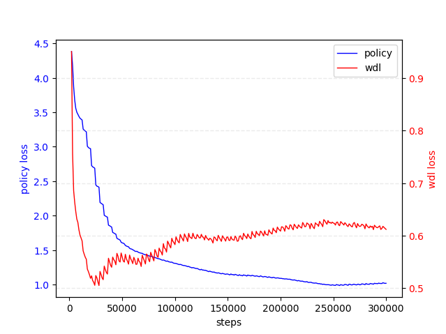
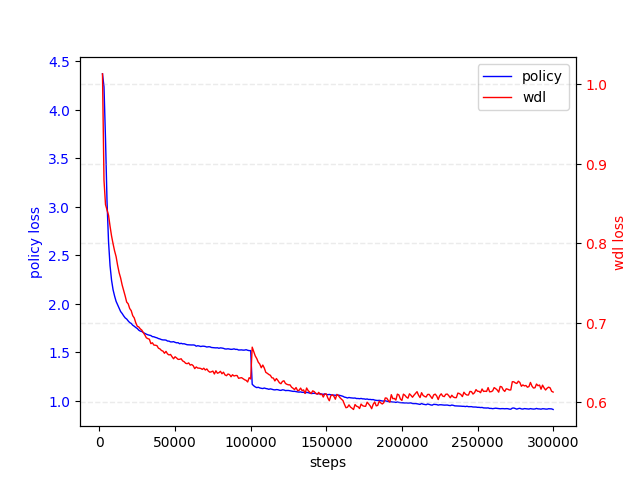
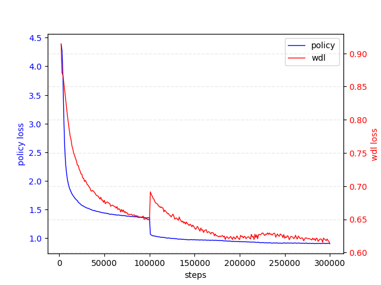
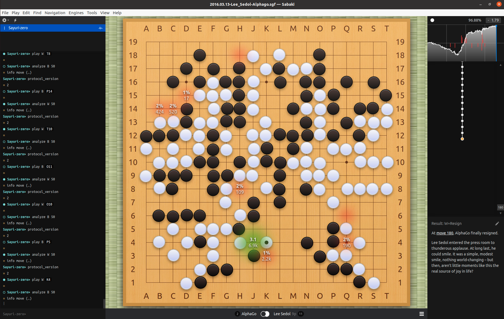
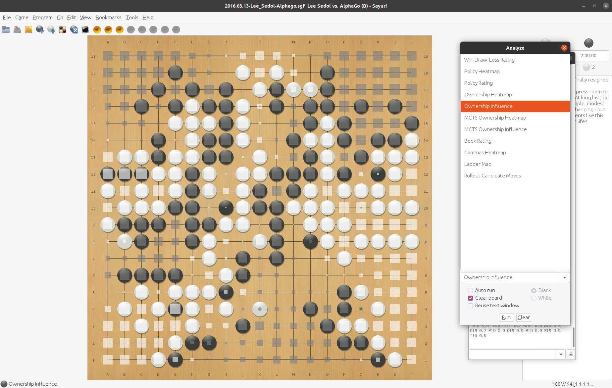
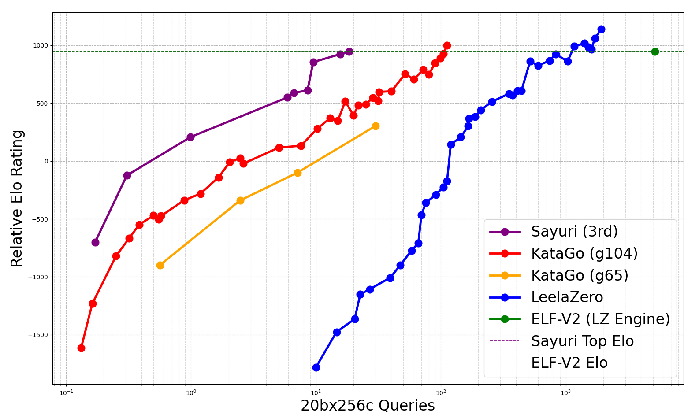

<div id="sayuri-art" align="center">
    </br>
    
    <h3>Sayuri</h3>
</div>

# TensorRT backend for ONNX

This is a prototype of the TensorRT backend for ONNX (onnx-tensorrt) designed for Sayuri.
AQ already adopted this method (using UFF instead of ONNX) in 2018, but there were still many restrictions at that time, so it was not adopted in the Go engine for a while.
Also added the following features:
* Muon+AdamW optimizer
* Aurora+AdamW optimizer
* torch.compile
* TransformerAttention model for demonstration purposes
* Automatic learning rate scheduling

## Requirements

Additional features require the following installation:

* c++ engine: onnx runtime (Used onnxruntime-linux-x64-1.25.1 to check the operation)
* python: pip install onnxruntime-gpu onnx onnxscript

## Modification of configuration definitions (selfplay-setting.json)

Additional configuration definitions (selfplay-setting.json):
```
  "NeuralNetwork" : {
    "ReductionInput": false(default)  # Should it be trained using minimal local input features? (true|false)
    "FFNExpansionRatio": 1.5(default) # What should be the multiplier for the number of output channels of the convolution
                                      # immediately following the DepthwiseConv in MixerBlock,
                                      # relative to the number of channels in the intermediate layer?
    "TransformerDropRate": 0.0(default) # Dropout rate used in the TransformerAttentionBlock.
    "BatchNormMode": "renorm"(default)  # Type of batch normalization to use. ("renorm"|"norm"|"fixup")
                                        # In the TransformerAttentionBlock, RMSNorm is fixed.
    "PreActivation": false(default) # Should batch normalization and activation be performed before the convolution? (true|false)
                                    # In the TransformerAttentionBlock, PreNorm is fixed.
    "FinalBlockCgroupSize": None(default) # If specified, RMSNorm is performed using this group size at the end of the intermediate layer's iterative processing.
    "AttentionQKNorm": true(default)  # RMSNorm on Q and K per-head before the attention dot product. (true|false)
    "TransformerHeads": 3(default)    # The number of parallel heads processed in Multi-Head Attention.
    "TransformerKVHheads": 3(default) # The number of parallel heads processed in Multi-Head Attention.
    "AttentionQueryHeadDim": 64(default) # Query size (number of dimensions) per head.
                                         #  = Hidden layer dimension / Number of attention heads.
                                         # The recommended value is 64.
    "AttentionValueHeadDim": 64(default) # Value size (number of dimensions) per head.
                                         #  = Hidden layer dimension / Number of attention heads
                                         # The recommended value is 64.
    "LearnedRoPECastToInputDtype": true(default) # Under AMP, cast the small cos/sin rotation tables to the input dtype
                                                 # before the batch-sized Q/K rotation,
                                                 # instead of promoting the batch-sized rotation intermediates to FP32.
                                                 # The trigonometric functions themselves remain FP32.
    "TransformerFFNRatio": 4(default) # By what factor should the expanded channel count in the feed-forward network within the TransformerAttentionBlock
                                      # be set relative to the number of channels in the intermediate layer?
    "UseSwiGLU": true(default) # Should SiLU be used for the activation within the Feed-Forward Network of the TransformerAttentionBlock? (true|false)
                               # If set to false, the activation function specified in "Activation" is used.
    "TransformerFFNDepthwiseConv": true(default) # Should DepthwiseConv be used within the feed-forward network of a TransformerAttentionBlock? (true|false)
    "FusedQKVProj": false(default) # Currently unavailable because ONNX export is not supported. (true|false)
    "FusedSwigluKernel": false(default) # Currently unavailable because ONNX export is not supported. (true|false)
    "FusedRoPEBackward": false(default) # Currently unavailable because ONNX export is not supported. (true|false)
    "UseTAB": false(default) # Should we use Topological Attention Bias? (true|false)
    "TABD1": 16(default) # Number of output channels for TAB first Layer.
    "TABD2": 16(default) # Number of output channels for TAB second Layer.
    "TABCZ": 32(default) # Number of TAB frequencies.
    "TABNumTemplates": 32(default) # Number of TAB templates.
    "TABNumFreqs": 8(default)  # Number of TAB frequencies.
    "TABNumBlocks": 3(default) # Number of TAB blocks.
    "TABDilation": 3(default)  # Dilation for conv2d in TAB.
    "UseFlexAttention": false(default)  # Should we use PyTorch's FlexAttention? (true|false)
                                        # At present, torch.onnx.export does not support this;
                                        # setting it to true will cause the training process to terminate abnormally.
    "AttnLogitPenaltyCap": None(default)      # Penalize attention layers whose per-head logit upper bound (scale * max||q|| * max||k||, incl off-board positions) exceeds this. None = disabled.
    "AttnLogitPenaltyCoeff": 1e-3(default)    # Loss coeff for the attention logit bound penalty (linear hinge, mean over heads, sum over layers, per sample)
    "AttnLogitPenaltyBatchFrac": 1.0(default) # Compute the attention logit penalty on only this fraction of each batch (cuts its cost proportionally, adds gradient variance)
  "Train" : {
    "Optimizer": "SGD"(default)               # ("SGD"|"Adam"|"Muon"|"Aurora")
    "LearningRateAnnealingBase": 0(default)   # curr_lr = max_lr * math.sqrt("LearningRateAnnealingBase" / ("LearningRateAnnealingBase" + curr_steps - "WarmUpSteps"))
    "HeadLrFactor": 0.5(default)     # LR factor for output head weights.
    "NoregLrFactor": 1.0(default)    # LR factor for noreg params. (biases, norms)
    "MuonAdamLrFactor": 1.0(default) # LR factor for muon-ineligible (adam) params when using muon.
    "InputWdFactor": 1.0(default)    # Extra scaling factor for input weight decay.
    "NormalWdFactor": 1.0(default)   # Extra scaling factor for normal weight decay.
    "NormalAttnWdFactor": 1.0(default)  # Extra scaling factor for normal_attn weight decay.
    "ExportONNX": false(default)        # Should we export the trained model using torch.onnx.export? (true|false)
    "UseDynamo": true(default)          # Should we use TorchDynamo when exporting with torch.onnx.export? (true|false)
    "UseCompile": false(default)        # Should we use torch.compile? (true|false)
    "UseBatchedMuonNs": true(default)   # Stack Muon updates with the same
                                        # matrix shape (up to KATAGO_MUON_NS_BATCH_SIZE, default 32) into a single
                                        # compiled Newton-Schulz iteration rather than one launch sequence per
                                        # parameter. Same update equations, but not bitwise identical to the scalar launches.
    "UseForeachAuxAdam": true(default)  # Use torch._foreach multi-tensor kernels for the auxiliary Adam parameter groups.
    "MuonNsBatchSize": 32(default)      # Newton-Schulz batch size.
    "WdFloorFraction": None(default)    # Exempt from weight decay the part of each output channel of each weight matrix
                                        # whose RMS is below this fraction of the tensor's RMS at initialization,
                                        # so that unused channels never decay to exactly zero,
                                        # a state Muon cannot recover from.
                                        # Can be changed between runs.
                                        # Requires muon.
```
Deletion configuration definition (selfplay-setting.json):
```
  "Train" : {
    "RenormMaxR": 1(default)
    "RenormMaxD": 0(default)
```

## About the Transformer model

The Transformer model currently implemented is merely a prototype for demonstration purposes.
Various improvements are needed to make it more powerful.

## Test results using a Transformer model on a 9x9 Go board

Build
```
 $ cmake .. -DBLAS_BACKEND=TENSORRT -DUSE_ZLIB=1 -DSPECIFIC_BOARD_SIZE=9 -DBOARD_SIZE=9 -DONNX_ROOT_DIR=~/Downloads/onnxruntime-linux-x64-1.25.1
 $ cmake --build .
 $ ./sayuri -t 10 -b 5 -w ~/Sayuri-test-b9xc192/weights/sayuri-b9xc192-s300000-c315000-w61965-swa.onnx --use-optimistic-policy --scoring-rule area -p 1200 --reuse-tree
       Sayuri 10.0.0 ()  Copyright (C) 2021-2025  Hung Tse Lin
       Copyright (C) 2025-2026  MAOmao000
       This program comes with ABSOLUTELY NO WARRANTY.
       This is free software, and you are welcome to redistribute it
       under certain conditions; see the COPYING file for details.
   Network Version: 5
   Input Channels: 43
   Residual Blocks: 9
   Residual Channels: 192
     block 1: ResidualBlock
     block 2: ResidualBlock
     block 3: TransformerBlock
     block 4: ResidualBlock
     block 5: ResidualBlock
     block 6: TransformerBlock
     block 7: ResidualBlock
     block 8: ResidualBlock
     block 9: TransformerBlock
   Policy Head Type: RepLK
   Policy Head Channels: 48
   Value Head Channels: 48
   Load the ONNX model file from: ~/Sayuri-test-b9xc192/weights/sayuri-b9xc192-s300000-c315000-w61965-swa.onnx.
   CUDA version: Major 13(12), Minor 2(8)
   Blas backend: TensorRT
   TensorRT version: 10.13.2(10.13.2)
   Number of CUDA devices: 1
   === Device: 0 ===
     Name: NVIDIA GeForce RTX 5060
     Compute capability: 12.0
     Disable the FP16
     Enable the tensor cores
   Allocated 400.00 MiB memory for NN cache (579324 entries).
```
* b3xc192h64 RRTx1



* b6xc192h64 RRTx2



* b9xc192h64 RRTx3



```
Rank Name                                                       Elo    +    - games score oppo. draws
   1 19x19 b12xc384nbt-s3592000-c4310000-w426561 original       166   49   49   197   81%   -80   19% 
   2 9x9 b8xc160 sai                                            -12   43   43   206   48%     6   23% 
   3 9x9 b9xc192h64 RRT3 Muon   silu fixup  RMSNormx  3.99e-5  -153   48   48   197   22%    73   19% 437.5K games
```

The following is the original README for Sayuri.

## Let's ROCK!

**Sayuri** is a GTP-compliant Go engine built on Deep Convolutional Neural Networks and Monte Carlo Tree Search. It learns to play Go from scratch using an AlphaZero-style algorithm, without any handcrafted human strategies. Inspired heavily by **Leela Zero** and **KataGo**, Sayuri initially borrowed its board data structures, search algorithms, and network format from Leela Zero. In later versions, the engine follows KataGo's research and now supports variable rulesets, komi settings, and board sizes.

For development insights and reports, see:
* [Development Log (in Chinese)](https://hackmd.io/@yrHb-fKBRoyrKDEKdPSDWg/BJgfay0Yc)
* [Performance Report before UEC15 (v0.6)](https://drive.google.com/file/d/1ATd_u-E-OnviczsDH8wVL0c3Q1NzUCKW/view?usp=share_link)


## Quick Start via Terminal

To run the engine, you need a executable weights first. The released weights can be got from this [page](./docs/MODEL.md). Then launching the engine with GTP mode via the terminal/PowerShell, using 1 thread and 400 visits per move with optimistic policy. Please type

    $ ./sayuri -w <weights file> -t 1 -p 400 --use-optimistic-policy


After executing the command, you'll see diagnostic output. If this output includes ```Network Version```, it indicates that the engine is successfully running in GPT mode. However, since GPT mode isn't designed for human interaction, you should use the graphical interface (GUI) instead. Please refer to the **Graphical Interface** section for more details.

For a list of additional command-line arguments, use the --help option. Please type:

    $ ./sayuri --help

The default engine uses a Chinese-like rule, which has a tendency to keep playing to remove some dead stones, even when their ownership of an area is clear. This can lead to unwanted capturing moves. To prevent these unnecessary moves, you have two options. First, while using the Chinese-like rule, add the ```--friendly-pass``` option. Second, switch to a Japanese-like rule by using the ```--scoring-rule territory``` option.

You can utilize the pure Python engine with a checkpoint model. The released checkpoint models could be found from this [page](./docs/MODEL.md). Although the Python engine is significantly weaker than the C++ engine, it makes running the raw model much easier. More detail you may see [here](./train/README.md).

    $ python3 train/torch/pysayuri.py -c model.pt --use-swa

## Execute Engine via Graphical Interface

Sayuri is not complete engine. You need a graphical interface for playing with her. She supports any GTP (version 2) interface application. [Sabaki](https://sabaki.yichuanshen.de/) and [GoGui](https://github.com/Remi-Coulom/gogui) are recommended because Sayuri supports some specific analysis commands.

* Sabaki analysis mode



* GoGui analysis commands



## Build From Source

For instructions on building from source, please refer to this [section](./docs/COMPILE.md). If you are using Windows, you can download a precompiled executable directly from the release page.

## Reinforcement Learning

Sayuri is a highly efficient self-play learning system for the game of Go that focuses on computational efficiency. In her v0.7 release, Sayuri’s training cost (represented by the purple line) is notably lower than that of both KataGo and Leela Zero. Compared to ELF OpenGo, Sayuri requires approximately 250× less computation. The complete training run was conducted in three months using a single RTX 4080 GPU. By comparison, KataGo’s g104 version reports a reduction of around 50×, making Sayuri’s efficiency improvement considerably larger.

For details on how to run the self-play loop, please refer to this [guide](./bash/README.md).



## Acknowledge

TensorRT Backend: The TensorRT backend has now been implemented in this project. Special thanks to [MAOmao000](https://github.com/MAOmao000) for providing a fully functional [TensorRT version](https://github.com/MAOmao000/Sayuri-TensorRT) and verifying that it delivers approximately 1.5x the performance of the original CUDA backend. Much of the TensorRT backend implementation in this project was adapted from that version and integrated to match the coding style of Sayuri.

## Other Resources

* Go Text Protocol, [https://www.gnu.org/software/gnugo/gnugo_19.html](https://www.gnu.org/software/gnugo/gnugo_19.html)
* Leela Zero, [https://github.com/leela-zero/leela-zero](https://github.com/leela-zero/leela-zero)
* KataGo methods, [https://github.com/lightvector/KataGo/blob/master/docs/KataGoMethods.md](https://github.com/lightvector/KataGo/blob/master/docs/KataGoMethods.md)
* [YouTube](https://www.youtube.com/watch?v=82UclNrXGxg), playing with Pachi.
* Supported analysis commands, [analyze](./docs/ANALYZE.md).
* [AlphaZero 之加速演算法實作 (v0.4~v0.5)](https://hackmd.io/@yrHb-fKBRoyrKDEKdPSDWg/HJI9_p70i), describe some methods for old version.

## License

The code is released under the GPLv3, except for threadpool.h, cppattributes.h, Eigen and Fast Float, which have specific licenses mentioned in those files.

## Contact

cglemon000@gmail.com (Hung-Tse Lin)
