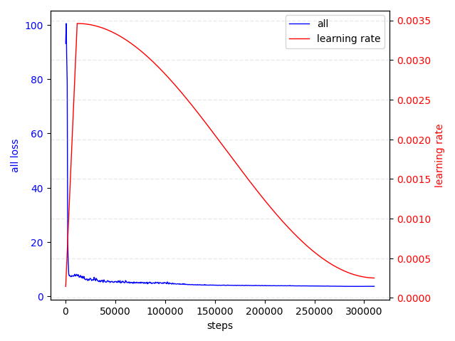
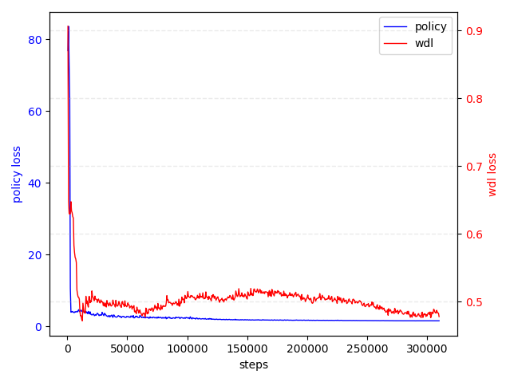
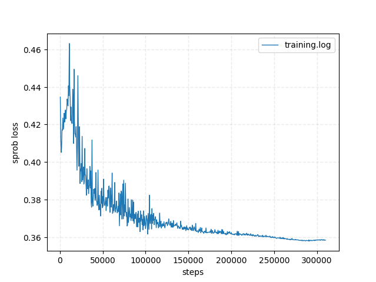
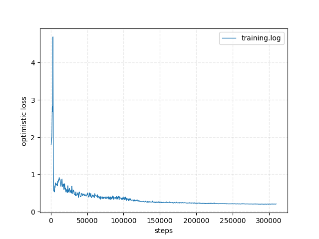
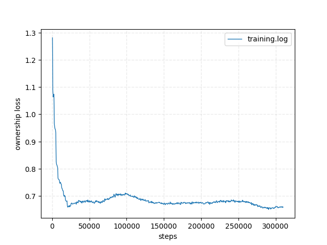

# Experiment-by-Experiment Technical Breakdown (Exp 1 – Exp 7)

This document provides an individual summary, architectural configuration, training dynamics, and key takeaways for each of the **eight experimental stages** (`Exp 1` through `Exp 7`) conducted on 9x9 Go (`Chinese rules`, `Komi 7.0`, evaluated over `200` games at `1,200 playouts/move` against `SAI b8c160`).

---

## Experiment 1: Baseline (`b6xc96h32` — Initial Muon + Gumbel AZ)

### 1. Objective & Configuration
Establish a clean baseline using a compact 6-block Hybrid ResNet-Transformer (`96ch`, `3 heads x 32 dim`) trained with standard (un-split) Muon optimization and Gumbel AlphaZero self-play.
* **Topology:** `b6xc96h32` (`Res-Res-Trans-Res-Res-Trans`, `ResidualChannels: 96`, `TransformerHeads: 3`, `head_dim: 32`)
* **Training:** `512K` steps, standard un-split Muon optimizer, Gumbel AZ self-play

### 2. Benchmark Results (vs. `SAI b8c160`)
* **Black (`W/D/L`):** `17 / 20 / 63` (Point Win Rate: `27.0%`)
* **White (`W/D/L`):** `14 / 17 / 69` (Point Win Rate: `22.5%`)
* **Total (`W/D/L`):** `31 / 37 / 132` (**Point Win Rate: `24.75%`**, **Est. Elo Diff: `-193 Elo`**, Non-Loss Rate: `34.0%`)

### 3. Key Findings
* While the hybrid architecture successfully learned basic 9x9 tactics and endgame scoring, it remained nearly `200 Elo` behind the 8-block `160ch` ResNet (`SAI b8c160`) even after `512K` steps.
* Orthogonalizing concatenated Q/K/V/Out projection matrices as a single block limited attention head specialization.

---

## Experiment 2: Naive Width Scaling (`b6xc192h64` — Un-split Muon + Damped Restart)

### 1. Objective & Configuration
Test whether simply doubling network width (`96ch -> 192ch`, ~4x parameters) and increasing head dimension (`32 -> 64`) could close the `193 Elo` gap.
* **Topology:** `b6xc192h64` (`ResidualChannels: 192`, `TransformerHeads: 3`, `head_dim: 64`)
* **Training:** `392K` steps with 2-stage search scaling and a damped warm restart, using standard un-split Muon without width-adjusted LR scaling

### 2. Benchmark Results (vs. `SAI b8c160`)
* **Black (`W/D/L`):** `23 / 22 / 58` (Point Win Rate: `33.0%`)
* **White (`W/D/L`):** `25 / 18 / 54` (Point Win Rate: `35.0%`)
* **Total (`W/D/L`):** `48 / 40 / 112` (**Point Win Rate: `34.00%`**, **Est. Elo Diff: `-115 Elo`**, Non-Loss Rate: `44.0%`)

### 3. Key Findings
* Scaling up parameters improved strength by `+78 Elo` over Exp 1, but still fell short of `SAI b8c160` (`-115 Elo`) despite requiring roughly 4x the compute per step.
* **Takeaway:** Raw parameter scaling without proper optimizer head-splitting and `muP` learning rate scaling yields diminishing returns.

*(Note: Due to randomized side assignment across 200 games, Black played 103 games and White played 97 games.)*

---

## Experiment 3: Algorithmic "Giant Killing" (`b6xc96h32` — Head-Split Muon + RMSNormMask)

### 1. Objective & Configuration
Return to the compact `b6xc96h32` (`96ch`) footprint and focus purely on optimization, normalization, and feature representation improvements.
* **Topology:** `b6xc96h32` (`ResidualChannels: 96`, `TransformerHeads: 3`, `head_dim: 32`, `FinalBlockCgroupSize: 24` [`4 x 24ch` spatial RMSNormMask], `AttnLogitPenaltyCap: 30.0`, `Full 43ch Input`)
* **Training:** `312K` steps single cycle (`Peak LR: 2.0e-2` with `muP` width adjustment), **Head-Split Muon** (orthogonalizing per `32`-dim head), 3-stage self-play curriculum (`150 -> 350 -> 500 playouts`)

### 2. Benchmark Results (vs. `SAI b8c160`)
* **Black (`W/D/L`):** `31 / 26 / 39` (Point Win Rate: `45.8%`, Non-Loss: `59.4%`)
* **White (`W/D/L`):** `21 / 13 / 70` (Point Win Rate: `26.4%`, Non-Loss: `32.7%`)
* **Total (`W/D/L`):** `52 / 39 / 109` (**Point Win Rate: `35.75%`**, **Est. Elo Diff: `-102 Elo`**, Non-Loss Rate: `45.5%`)
* *(Note: At the `308K` annealing trough prior to the `312K` cycle reset, the model scored `41/48/111` [`32.50%` Point Win Rate / `-127 Elo`]; a brief `12.5%` high-LR blend at `312K` unlocked sharper Black play, boosting Black from `20W` to `31W`.)*

### 3. Key Findings
* **Surpassed the 4x Larger Exp 2 Model:** Achieved `-102 Elo` in `312K` steps—beating `Exp 2` (`192ch`, `-115 Elo` at `392K` steps) with a quarter of the parameters.
* **Color Asymmetry:** Black became highly competitive (`31W - 39L`), whereas White struggled (`21W - 70L`) against `SAI`'s deep endgame refutations.

*(Note: Due to randomized side assignment across 200 games, Black played 96 games and White played 104 games.)*

---

## Experiment 3.5: Damped Warm Restart & Cycle Boundary Analysis (`b6xc96h32`, `312K -> 512K`)

### 1. Objective & Configuration
Test whether extending `b6xc96h32` via a Damped Warm Restart (`312K -> 512K` steps) with deeper search (`600 playouts`, `Gumbel: 160`) and tighter opening focus (`random-opening-prob: 0.15`) could overcome White's weakness and achieve overall parity.
* **Training:** `6K`-step pseudo-warmup (`3e-3 -> 6e-3 -> 9e-3`) followed by a `194K`-step cosine decay to `1e-4`; `PolicySurpriseFactor: 0.65`, `resign-threshold: 0.03`, `SwaMaxCount: 12`

### 2. Benchmark Results (vs. `SAI b8c160`)
* **At `508K` (Clean Annealing Trough):**
  * **Black (`W/D/L`):** `30 / 18 / 52` (Point Win Rate: `39.0%`)
  * **White (`W/D/L`):** `27 / 30 / 43` (Point Win Rate: `42.0%`, Non-Loss: `57.0%`)
  * **Total (`W/D/L`):** `57 / 48 / 95` (**Point Win Rate: `40.50%`**, **Est. Elo Diff: `-67 Elo`**, Non-Loss Rate: `52.5%`)
* **At `512K` (Post-Cycle LR Reset Contamination):**
  * **Total (`W/D/L`):** `41 / 53 / 106` (**Point Win Rate: `33.75%`**, **Est. Elo Diff: `-117 Elo`**, Non-Loss Rate: `47.0%`)

### 3. Key Findings
* **White's Weakness Solved (`+35 Elo` Net Gain):** At `508K`, White's Point Win Rate surged by `+15.6` percentage points (`26.4% -> 42.0%`), and training losses hit record lows (`all loss: 4.1880`, `scores loss: 0.0726`).
* **Two Crucial Training Traps Identified:**
  1. *Jigo (Draw) Over-Specialization:* Tightening `random-opening-prob` to `0.15` caused the model to overfit onto passive draw equilibrium lines, capping overall Point Win Rate at `40.50%` (`-67 Elo`).
  2. *SWA Cycle Boundary Sensitivity:* At `512K`, the cosine schedule modulo reset spiked LR back to `9.0e-3` during the final `1,000` steps. Just 2 post-spike checkpoints entering the 12-checkpoint SWA window degraded strength by `-50 Elo` (`-67 -> -117 Elo`).

---

## Experiment 4: `muP` Scaling & Single-Cycle Sweet Spot (`b6xc128h32`, `0 -> 312K`)

### 1. Objective & Configuration
Synthesize all lessons from Exp 1–3.5 to find the **smallest architecture capable of matching `SAI b8c160` in a single ~300K-step cycle without warm restarts**.
* **Topology:** `b6xc128h32` (`ResidualChannels: 128`, `TransformerHeads: 4`, `head_dim: 32`, `TransformerFFNChannels: 512`, `FinalBlockCgroupSize: 32` [`4 x 32ch` spatial RMSNormMask], `PolicyHeadChannels: 48`, `ValueHeadChannels: 96`)
* **Zero-Tuning `muP` Scaling:** Scaled Peak LR from `96ch` (`2.0e-2`) via `2.0e-2 * sqrt(96 / 128) = 1.73e-2`
* **Clean SWA Termination:** Set `WarmUpSteps: 12,000` and `LearningRateAnnealingCycle: 304,000` (trough at `316K`) so stopping at `312K` (`LR = 1.07e-4`) guaranteed zero LR spike contamination
* **Balanced 3-Stage Curriculum (`312K` steps total):**
  * Stage 1 (`0 – 48K`): `150 playouts` (`Gumbel: 32`), `random-opening-prob: 0.65`
  * Stage 2 (`48K – 160K`): `350 playouts` (`Gumbel: 85`), `random-opening-prob: 0.45`
  * Stage 3 (`160K – 312K`): `550 playouts` (`Gumbel: 140`), `random-opening-prob: 0.25`, `root-policy-temp: 0.90`, `score-utility-factor: 0.28`

### 2. Benchmark Results (vs. `SAI b8c160`)
* **Black (`W/D/L`):** `40 / 19 / 40` (**Point Win Rate: `50.0%`**, Non-Loss: `59.6%`)
* **White (`W/D/L`):** `26 / 29 / 46` (**Point Win Rate: `40.1%`**, Non-Loss: `54.5%`)
* **Total (`W/D/L`):** `66 / 48 / 86` (**Point Win Rate: `45.00%`**, **Est. Elo Diff: `-35 Elo`**, **Non-Loss Rate: `57.0%`**)
* **Final Convergence Metrics (`311K–312K`):** `all loss: 4.2327`, `prob loss: 1.5918`, `wdl loss: 0.6091`, `scores loss: 0.0686` (all-time best endgame score precision)

### 3. Key Findings
* **Target Achieved in One Pass:** Without any warm restarts or hyperparameter grid searches, `b6xc128h32` matched `SAI b8c160` 50/50 as Black (`40W - 40L`) and reached `57.0%` overall non-loss rate (`-35 Elo`) in `312K` steps—confirming `b6xc128h32` as the minimal architectural sweet spot for 9x9 Go.

*(Note: Due to randomized side assignment across 200 games, Black played 99 games and White played 101 games.)*

---

## Experiment 5: Multi-Config Exploration Mixture & Loss–Strength Paradox (`b6xc96h32`, `0 -> 500K`)

### 1. Objective & Configuration
Test whether mixing self-play data from three distinct MCTS search personalities per cycle—followed by a high-playout warm restart—could enable the compact `b6xc96h32` (`96ch`) model to match `Exp 4` (`128ch`).
* **Topology:** `b6xc96h32` (`ResidualChannels: 96`, `TransformerHeads: 3`, `head_dim: 32`, `FinalBlockCgroupSize: 32` [`3 x 32ch` spatial RMSNormMask], `PolicyHeadChannels: 32`, `ValueHeadChannels: 64`)
* **3-Personality Self-Play Mixture (per cycle):**
  * *Balance:* `score-utility-factor: 0.28 -> 0.35`, `fpu-reduction: 0.35`, `root-policy-temp: 0.90`
  * *Offense:* `score-utility-factor: 0.40`, `fpu-reduction: 0.15`, `root-policy-temp: 0.95`
  * *Defense:* `score-utility-factor: 0.15 -> 0.20`, `fpu-reduction: 0.40`, `root-policy-temp: 0.90`
* **Two-Phase Training Schedule (`500K` steps total):**
  * *Phase 1 (`0 – 300K`):* `150 playouts` (`Gumbel: 32`), multi-rule/multi-board-size (`7x7`, `8x8`, `9x9`; Chinese & Japanese rules), `Peak LR: 2.0e-2 -> 1.13e-3`
  * *Phase 2 (`300K – 500K` Warm Restart):* `600 playouts` (`Gumbel: 32`, `fastsearch: 100`), concentrated on 9x9 `Komi 7.0` (~83% Chinese / ~17% Japanese), `LR: 6.0e-3 -> 2.0e-4` (`LearningRateAnnealingCycle: 200,010`), `ChunksIncreasingC: 8000`, `SwaMaxCount: 24`

### 2. Benchmark Results (vs. `SAI b8c160`)
* **Phase 1 Checkpoint (`300K` steps, `150 playouts`):**
  * **Black (`W/D/L`):** `8 / 16 / 71` (Point Win Rate: `16.8%`)
  * **White (`W/D/L`):** `14 / 22 / 69` (Point Win Rate: `23.8%`)
  * **Total (`W/D/L`):** `22 / 38 / 140` (**Point Win Rate: `20.50%`**, **Est. Elo Diff: `-235 Elo`**, Non-Loss Rate: `30.0%`)
* **Phase 2 Trough Checkpoint (`492K` SWA, `600 playouts`, `--use-optimistic-policy`):**
  * **Black (`W/D/L`):** `11 / 26 / 52` (Point Win Rate: `27.0%`, Non-Loss: `41.6%`)
  * **White (`W/D/L`):** `22 / 21 / 68` (Point Win Rate: `29.3%`, Non-Loss: `38.7%`)
  * **Total (`W/D/L`):** `33 / 47 / 120` (**Point Win Rate: `28.25%`**, **Est. Elo Diff: `-162 Elo`**, **Non-Loss Rate: `40.0%`**)
* **Peak Training Metrics (`492K` trough):** `all loss: 3.8088`, `prob loss: 1.3252`, `ownership loss: 0.7545`, `wdl loss: 0.5718`, `scores loss: 0.0746` (lowest overall training loss across all experiments)

### 3. Key Findings
* **Substantial Intra-Model Gain (`+73 Elo`):** High-playout (`600`) warm restart distillation with optimistic policy search boosted Point Win Rate by `+7.75%` (`20.50% -> 28.25%`), raising Black's point win rate by `+10.2` percentage points (`16.8% -> 27.0%`).
* **The Training Loss vs. Elo Paradox:** Despite achieving lower training losses (`all loss: 3.8088`) than `Exp 4` (`4.2327`), Exp 5 trailed `Exp 4` (`45.00%` Point Win Rate) by `127 Elo`. Narrowing rule/komi distributions in Phase 2 induced *policy distribution contraction*—allowing the `96ch` model to tightly imitate its own self-play trajectories without acquiring the out-of-distribution generalization required against `SAI b8c160` at `1,200 playouts`.
* **Takeaway:** Multi-config exploration diversity and high-playout distillation reliably strengthen a fixed topology, but cannot substitute for sufficient channel capacity (`128ch`) and `scores loss` precision (`0.0686`) in deep-search competitive play.

---

## Experiment 6: 100% Pure Gumbel AlphaZero & Multi-Personality Mixture (`b6xc96h32`, `0 -> 312K`)

### 1. Objective & Configuration
Evaluate the pure behavior of **100% Gumbel AlphaZero** (setting `--gumbel-playouts-threshold 400` so every move uses Sequential Halving at low playout counts) paired with Fixup normalization, `TransformerBlock + Muon`, and a 3-personality self-play mixture (`Balance` 47%, `Offense` 26.5%, `Defense` 26.5%) in a single `312K`-step cycle without warm restarts.
* **Topology:** `b6xc96h32` (`Res-Res-Trans-Res-Res-Trans`, `ResidualChannels: 96`, `TransformerHeads: 3`, `head_dim: 32`, `FinalBlockCgroupSize: 32` [`3 x 32ch` spatial RMSNormMask], `BatchNormMode: fixup`, `AttnLogitPenaltyCap: 30.0`)
* **Training & Self-Play Schedule (`312K` steps total):**
  * **Optimizer:** `Head-Split Muon` (`WarmUpSteps: 12,000`, `LearningRateAnnealingCycle: 300,010` $\rightarrow$ trough at `312,010`), Peak LR adjusted from `2.0e-2` to **`4.0e-3 -> 3.0e-4`** at `12K` steps (`MuonAdamLrFactor: 0.25`), `MaxStepsPerRunning: 1,500 -> 2,500` at `72K` steps
  * **Search Budget:** `64 playouts` (`0 – 33K`) $\rightarrow$ `96 playouts` (`33K – 312K`), `100% Pure Gumbel`, mixed rules (`Chinese` & `Japanese`), dynamic komi, handicap up to 4 stones, and `2%` `7x7`/`8x8` boards

### 2. Benchmark Results (vs. `SAI b8c160` at `1,200 playouts`)
* **With Conservative Evaluation Search (`--lcb-reduction 0.5`, `--score-utility-factor 0.35`):**
  * **Black (`W/D/L`):** `15 / 14 / 69` (Point Win Rate: `22.4%`, Non-Loss: `29.6%`)
  * **White (`W/D/L`):** `3 / 14 / 85` (Point Win Rate: `9.8%`, Non-Loss: `16.7%`)
  * **Total (`W/D/L`):** `18 / 28 / 154` (**Point Win Rate: `16.00%`**, **Est. Elo Diff: `-288 Elo`**, Non-Loss Rate: `23.0%`)
* **With Neutral Evaluation Search (`--lcb-reduction 0.0`, `--score-utility-factor 0.15`):**
  * **Black (`W/D/L`):** `13 / 8 / 76` (Point Win Rate: `17.5%`, Non-Loss: `21.6%`)
  * **White (`W/D/L`):** `16 / 12 / 75` (Point Win Rate: `21.4%`, Non-Loss: `27.2%`)
  * **Total (`W/D/L`):** `29 / 20 / 151` (**Point Win Rate: `19.50%`**, **Est. Elo Diff: `-246 Elo`**, **Non-Loss Rate: `24.5%`**)
* **Final Convergence Metrics (`312K` trough):** `all loss: 3.9899`, `prob loss: 1.5911`, `aux prob loss: 0.3478`, `soft prob loss: 0.3539`, `ownership loss: 0.6840`, `wdl loss: 0.5107`, `scores loss: 0.0852`

### 3. Key Findings
* **Unique Training Curve Dynamics:** Combining `TransformerBlock + Muon` with high-entropy Pure Gumbel multi-style self-play compressed global value representations (`ownership`, `wdl`, `scores`) into a flat L-shaped plateau by `25K` steps—far faster than conventional CNN+SGD runs—while `PolicySurpriseFactor: 0.5` drove regular sawtooth waves that steadily refined policy accuracy (`prob loss: 1.5911`) without collapsing `soft prob loss` (`0.3539`).
* **LCB Penalty Sensitivity on Compact Models:** Removing `--lcb-reduction 0.5` (`-> 0.0`) and lowering `--score-utility-factor` (`0.35 -> 0.15`) boosted White wins more than 5x (`3W -> 16W`, `+42 Elo` overall), eliminating color asymmetry against `SAI b8c160`.
* **Search Ceiling vs. Parameter Scaling:** Despite achieving clean convergence at just `64–96` self-play playouts in a single `312K`-step pass (nearly matching `Exp 5`'s `300K` `150-playout` Phase 1 checkpoint of `-235 Elo` with ~40% less search compute), beating `SAI b8c160` consistently requires scaling width to `128ch` (`b6xc128` or `b8xc128` `RRRTRRRT`) and increasing self-play search depth (`>= 128–160 playouts`).

---

## Experiment 7: Full Synthesis & Surpassing `SAI b8c160` (`b6xc128h32`, `0 -> 310K`)

### 1. Objective & Configuration
To verify the combined validity of all architectural, optimization, and self-play insights discovered across `Exp 1 – Exp 6`, we designed a unified single-cycle experiment using the compact **`b6xc128h32` (`RRTRRT`)** topology and evaluated its final strength against both `SAI b8c160` and the massive upstream `Sayuri b12xc384nbt` engine.
* **Topology:** `b6xc128h32` (`Res-Res-Trans-Res-Res-Trans`, `ResidualChannels: 128`, `TransformerHeads: 4`, `AttentionHeadDim: 32`, `TransformerFFNChannels: 512`, `PolicyHeadChannels: 48`, `ValueHeadChannels: 96`, `FinalBlockCgroupSize: 32` [`4 x 32ch` spatial RMSNormMask], `BatchNormMode: fixup`, `AttnLogitPenaltyCap: 30.0`)
* **Optimizer & Clean SWA Termination:** `Head-Split Muon` (`WarmUpSteps: 12,000`, `Peak LR: 3.46e-3 -> 2.50e-4`, `LearningRateAnnealingCycle: 300,010` $\rightarrow$ trough at `312,010`, `MuonAdamLrFactor: 0.25`). Training was stopped cleanly at **`310,000` steps** (~400,000 self-play games) prior to the cosine cycle reset to guarantee zero LR-spike contamination in the trailing SWA checkpoints.
* **Two-Stage Gumbel Curriculum & 3-Personality Mixture:**
  * *Stage 1 (`0 – 100K` steps):* `128 playouts` (`100% Pure Gumbel`), `80%` 9x9 + `20%` 7x7/8x8 boards
  * *Stage 2 (`100K – 310K` steps):* `256 playouts` (Gumbel + PUCT hybrid), `95%` 9x9 + `5%` 7x7/8x8 boards (retaining `5%` auxiliary board sizes to prevent late-stage distribution contraction)
  * *Self-Play Mixture (all stages):* `Balance` (~47%), `Defense` (~26.5%, `cpuct-init: 0.30`, `lcb-reduction: 0.5`, `score-utility: 0.08`), and `Offense` (~26.5%, `cpuct-init: 0.85`, `score-utility: 0.85`, `komi-stddev: 3.5`)

### 2. Training Curves & Convergence Dynamics
Unlike earlier runs that suffered from early divergence or late-stage plateauing, `Exp 7` exhibited textbook monotonic convergence across all loss heads:

| Overall Loss & LR Schedule | Policy & WDL Convergence |
| :---: | :---: |
|  |  |

| Score Margin Loss (`100K` Step Inflection) | Soft Policy Stability (`soft prob loss`) |
| :---: | :---: |
|  |  |

| Optimistic Policy Convergence | Board Ownership & Life/Death Loss |
| :---: | :---: |
|  |  |

* **Visible `100K` Curriculum Inflection (`score loss` & `ownership loss`):** After plateauing around `scores loss: ~0.095` at `128 playouts`, switching to `256 playouts` at `100K` steps triggered an immediate secondary descent—driving `scores loss` down to **`0.0540`** and `ownership loss` down to **`0.6581`** by `310K` steps.
* **Late-Stage Endgame Breakthrough (`wdl loss`):** From `170K` to `310K` steps, `wdl loss` steadily declined (`0.517 -> 0.4776`) without rebounding, demonstrating that sub-0.06 score precision enabled the network to accurately resolve half-point (*Jigo*-boundary) close games.
* **Zero Overfitting Signature (`soft prob loss` & `optimistic loss`):** `soft prob loss` settled into a completely flat horizontal baseline at **`0.3585`** while `optimistic loss` smoothly converged to **`0.199`–`0.204`**, confirming that multi-personality self-play preserved full strategic breadth without mode collapse.
* **Final Convergence Metrics (`310K` steps):** `all loss: 3.6956`, `prob loss: 1.4280`, `aux prob loss: 0.3213`, `soft prob loss: 0.3585`, `optimistic loss: 0.2048`, `ownership loss: 0.6581`, `wdl loss: 0.4776`, `scores loss: 0.0540`.

### 3. Benchmark Results (`200` Games @ `1,200` Playouts, Neutral Evaluation)
Evaluated using our neutral inference configuration (`--lcb-reduction 0.0 --score-utility-factor 0.15 --cpuct-init 0.70 --use-optimistic-policy --reuse-tree`):

#### A. vs. `SAI b8c160` (8-Block, `160ch` ResNet)
* **Black (`W/D/L`, 99 games):** `39 / 24 / 36` (**Point Win Rate: `51.52%`**, Non-Loss: `63.6%`)
* **White (`W/D/L`, 101 games):** `37 / 33 / 31` (**Point Win Rate: `52.97%`**, Non-Loss: `69.3%`)
* **Total (`W/D/L`, 200 games):** **`76 / 57 / 67`** (**Point Win Rate: `52.25%`**, **Est. Elo Diff: `+16 Elo`**, **Non-Loss Rate: `66.5%`**)

#### B. vs. Original Upstream Sayuri (`b12xc384nbt` — 12-Block NestedBottleneck, `384ch`, `SGD`, `3,592K` Steps)
* **Black (`W/D/L`, 100 games):** `15 / 21 / 64` (Point Win Rate: `25.50%`, Non-Loss: `36.0%`)
* **White (`W/D/L`, 100 games):** `15 / 21 / 64` (Point Win Rate: `25.50%`, Non-Loss: `36.0%`)
* **Total (`W/D/L`, 200 games):** **`30 / 42 / 128`** (**Point Win Rate: `25.50%`**, **Est. Elo Diff: `-186 Elo`**, **Non-Loss Rate: `36.0%`**)

### 4. Key Findings & Final Conclusions
1. **Near-Optimal Learning on a Compact Footprint:** Within the constraints of neural scaling laws, `b6xc128h32` (`RRTRRT`) demonstrated that near-maximal learning quality is achievable in 9x9 Go—defeating the larger `SAI b8c160` baseline across both colors (`+16 Elo`) while completely eliminating White's earlier endgame fragility (`40.1%` in Exp 4 $\rightarrow$ `52.97%` in Exp 7).
2. **Search Depth & Capacity Boundaries (`b12xc384nbt` Matchup):** Against the original upstream `Sayuri b12xc384nbt` (which lacks all experimental additions in this fork, but was trained with `SGD` over `3,592K` steps with ~15x more parameters), `Exp 7` achieved exact color symmetry (`15/21/64` for both sides) and a `36.0%` non-loss rate (`-186 Elo`). This confirms that while Gumbel AlphaZero offers superior sample efficiency, overcoming massive disparities in training playout budgets and network scale still requires proportional model scaling.
3. **Final Concluding Summary:**
   * **Data diversity is indispensable** for stable, non-collapsing reinforcement learning under fast orthogonalized optimizers.
   * **Peak Elo progression requires appropriate model scale and deep search budgets** once algorithmic efficiency has been maximized.
   * **High-impact RL research is viable on single-GPU hardware:** Using our proposed architecture and training pipeline, a compact `b6xc128h32` model trained over just **~400K self-play games and 310K steps** provides a fast, reproducible, and competitive experimental platform—concluding this series of experiments.

